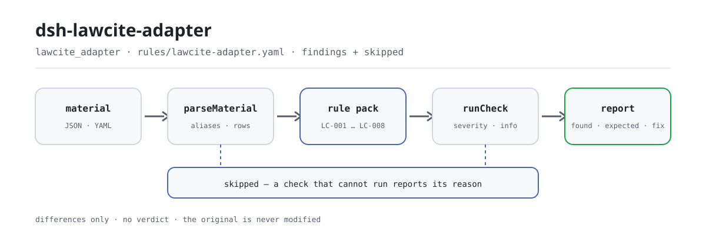

<div align="center">

<picture>
  <source media="(prefers-color-scheme: dark)" srcset="docs/assets/dsh-lawcite-adapter-flow-dark.svg">
  
</picture>

# dsh-lawcite-adapter

**Check every citation in a legal document for a law name, an article number, a transcribed quotation, a configured power status and the document's own elements — and get back a list of what is inconsistent, where, and what to fix.**

A citation checker for DeepSeek Harness, built for lawyers, legal counsel and document drafters: the rule pack cites its basis for every check, reports only literal differences against those elements, never decides compliance, never assigns liability, never touches your original.

[Install](#three-step-setup) · [Configuration](#configuration) · [FAQ](#faq) · [简体中文](README.md) · [English](README.en.md) · [Español](README.es.md) · [Português](README.pt.md) · [हिन्दी](README.hi.md)

[](LICENSE)
[](#compatibility)
[](https://www.npmjs.com/package/dsh-lawcite-adapter)
[](https://github.com/PerryLink/dsh-lawcite-adapter/actions/workflows/ci.yml)
[](#compatibility)

[](https://github.com/PerryLink/dsh-lawcite-adapter/stargazers)
[](https://www.npmjs.com/package/dsh-lawcite-adapter)
[](https://dshfind.com/plugins/PerryLink/dsh-lawcite-adapter?ref=badge)
[](https://securityscorecards.dev/viewer/?uri=github.com/PerryLink/dsh-lawcite-adapter)
[](https://dsh.market/)
[](https://gitee.com/perrylink/dsh-lawcite-adapter)

```sh
dsh plugin --profile <name> add dsh-lawcite-adapter
```

</div>

<sub>Community plugin, not affiliated with DeepSeek. Canonical repository: <https://github.com/PerryLink/dsh-lawcite-adapter> (Gitee is a mirror).</sub>

## What it is

`dsh-lawcite-adapter` reads one citation inventory — the document header plus one row per citation — and checks what such an inventory can be held to mechanically: that each citation states its law and article number, that the article number follows the Chinese form, that a direct quotation has been transcribed into the quotation column, that the power status comes from your own vocabulary, that the citation states where it is used and what it argues, that the document header names its title and type, that citation numbers are not repeated, and that no unreplaced placeholder survives in the quotation column. You hand it the source material (a table, register or document; Excel can be converted to JSON/YAML first, in chat if the platform supports it) and it returns a list of differences. It does not verify that a statute exists, that it is currently in force, that it has not been amended or repealed, or that it applies to the case. It does not decide compliance, does not assign liability, does not replace the reviewer — and it never modifies the original.

## Three-step setup

1. **Install**:

   ```sh
   dsh plugin --profile <name> add dsh-lawcite-adapter
   ```

   Alternatively, search "Documents and Governance Check Suite" in WorkBuddy / Coze (the full set; this check is one part of it; availability as listed).

2. **Minimal config** (works out of the box):

   ```yaml
   - insert:
       - id: dsh-lawcite-adapter
         name: dsh-lawcite-adapter
   ```

   Every tunable lives in the Schemastery schema in `src/config.ts` and the defaults are production-ready; per-rule thresholds live in the rule pack under `rules/`.

3. **Verify it mounts**:

   ```sh
   dsh --profile <name> --dump-config | grep 'dsh-lawcite-adapter'
   ```

   Then run the bundled sample (about a minute):

   ```sh
   node samples/quickstart/run.mjs --check
   ```

   Sample input lives in `samples/quickstart/input/`, the expected output in `samples/quickstart/expected/result.json`, and a captured run in `docs/assets/quickstart.png`.

**Uninstall**: `dsh plugin --profile <name> remove dsh-lawcite-adapter` (or remove the row from the profile patch).

<details>
<summary>Install from the DSH Desktop market</summary>

Every PerryLink plugin is listed in the built-in DSH Desktop market: **Market → Sources → Add source → paste** `https://perrylink-dsh-catalog.perrylink.workers.dev/catalog-source.json` **→ select**. Installation still requires the market's npm identity check and your confirmation.

</details>

## Core capabilities

The plugin registers the `lawcite_adapter` tool: it reads one citation inventory (the document header plus one row per citation), applies a versioned rule pack, and returns a structured report.

- **The rule pack is data, not code** — every rule lives in `rules/lawcite-adapter.yaml`; swapping the file switches the rule set without touching TypeScript, and the pack is validated on load, not trusted.
- **Severity follows the evidence** — a rule resting on your institution's own configuration (`institutional-configuration`) is capped at `info`; one resting on a general principle (`derived-from-principle`) is capped at `warn`; neither can ever be declared `error` (a test asserts this). All eight rules currently carry `institutional-configuration` at `info`.
- **An empty issue list is never "all clear"** — every check that could not run reports itself in `skipped` with its reason, and a rule whose required list is unset reports itself in `skipped` rather than passing silently (`LC-004`'s `values` ships empty).
- **No adjudication** — the report lists differences and never pronounces on compliance, liability or correctness; a wording guard forces the report to always carry the disclaimer.
- **Basis stated as found** — every rule carries a document, a document number, a clause description, an excerpt and the URL it was read from; an excerpt must be a real quotation of at least eight characters. When the verbatim text could not be obtained the excerpt says so and the rule is marked as principle-derived or institution-configured — a paraphrase is never presented as a quotation.

```text
citation inventory (header · one row per citation) ──lawcite_adapter──▶ rule pack LC-001…LC-008 ──▶ report (findings + skipped)
        ▲                                                                                              │
        └────────────────────────────── original never modified ──────────────────────────────────────┘
```

### Rules at a glance

| Rule | Check | Severity | Basis kind |
|---|---|---|---|
| `LC-001` | the law name and article number are stated | info | local |
| `LC-002` | the article number follows the Chinese form | info | local |
| `LC-003` | a direct quotation is transcribed | info | local |
| `LC-004` | the power status comes from your vocabulary (off by default) | info | local |
| `LC-005` | the citation states its location and purpose | info | local |
| `LC-006` | the document names its title and type | info | local |
| `LC-007` | citation numbers are unique | info | local |
| `LC-008` | the quotation column holds no unreplaced placeholder | info | local |

`LC-004` ships with an empty value list, so it reports itself in `skipped` until you configure one — it never passes silently.

### Examples

These are the plugin's real entry points; install once, then call one.

**Detailed output** — tool `lawcite_adapter`, input:

```json
{"documentTitle":"某某买卖合同纠纷起诉状","documentType":"民事起诉状","rows":[{"法律法规名称":"","条号":"","引用原文":"当事人一方不履行合同义务或者履行合同义务不符合约定的，应当承担继续履行、采取补救措施或者赔偿损失等违约责任。"}]}
```

Output:

```json
{
  "id": "dsh-lawcite-adapter.LC-001.de09b5a6",
  "ruleId": "LC-001",
  "severity": "info",
  "locator": {
    "row": 1,
    "field": "lawName"
  },
  "found": "第 1 行 lawName、articleNo 都为空",
  "expected": "lawName、articleNo 至少应填写一项"
}
```

*Observed from `dsh-lawcite-adapter/tests/fixtures/LC-001/LC-001-unsafe.json`*

This is the plugin's **real output** for its own `LC-001` fixture, not an illustration. The rule pack never fabricates a citation, so every finding states both the basis it was read from and the fact that the basis text itself was not obtained in this round.

### What it answers

| You ask | What it answers |
|---|---|
| A citation row carries an article number but the law name is blank. Is that reported? | Yes. `LC-001` requires the law name and the article number (`lawName`, `articleNo`) on every row and reports the row that leaves either one blank. It checks that they are written, not that the statute or the article exists: it holds no statute database and does not query one. |
| The article number is written with a space inside it, or with a paragraph number appended. Will it pass? | `LC-002` validates `articleNo` against the anchored pattern documented under "Material format", so a spaced form and a mixed form are both reported. It checks the form of the number only, nothing about whether the article exists; a paragraph or item number belongs in its own column, so the article column keeps only the article part. The `pattern` is adjustable to your house style. |
| One row's quotation column is empty and another still holds a template placeholder. Are both caught? | Yes, by two rules. `LC-003` requires `quotedText` to be transcribed on every row; `LC-008` reports the row whose `quotedText` still contains a template term (the shipped list covers template brackets and braces, an X-run placeholder, and the ordinary fill-me-in markers; the exact list is documented in the rule pack). Neither compares the text with the statute: `LC-003` checks that a quotation is present, `LC-008` only that no placeholder survives. The abridgement marker is deliberately absent from the terms, so a normal long-quotation ellipsis passes. |
| The report shows `LC-004` as `skipped` instead of passing. Why? | Because `LC-004`'s `values` list ships empty, meaning the power-status vocabulary is not configured, so the rule reports itself in `skipped` rather than passing silently. Fill `values` with your own vocabulary (for example the local terms for in force, amended, repealed) and `LC-004` then checks that `effectiveStatus` is on that list. It checks membership in your list, not whether the recorded status matches the facts. |
| The rows name the law and quote it, but say nothing about where the citation is used or what it argues, and the header gives no document type. Is that reported? | Yes. `LC-005` requires `usage` and `purpose` on every citation row and reports a row that leaves both blank; it does not judge whether the citation really supports that argument. `LC-006` requires the header to declare `documentTitle` and `documentType`, and does not judge whether the type was chosen correctly. |
| The same article is cited in two sections and both rows carry citation number 3. Is that a finding? | Yes. `LC-007` reports a `citationNo` that repeats inside the inventory, because a repeated number stops the footnotes from locating each citation. Citing the same provision in several sections is normal: give each citation its own number. The rule does not judge whether citing the same provision twice is appropriate. |

## Configuration

Every tunable lives in the Schemastery schema in `src/config.ts`, so it can be changed from `cordis.yml` without editing code; per-rule thresholds live in the rule pack under `rules/`. The five keys below are the complete list; rule-level parameters follow.

| Key | Type | Default | Description |
|---|---|---|---|
| `rulesFile` | string | `rules/lawcite-adapter.yaml` | Rule-pack path, relative to the package root |
| `disabledRules` | string[] | `[]` | Rule ids to stop running; each appears in `skipped` |
| `onlyRules` | string[] | `[]` | Run only these rule ids; empty runs every rule |
| `skipNotes` | string | `""` | Note appended to every `skipped` reason |
| `timeoutMs` | number | `120000` | Cooperative tool timeout budget |

Rule-level parameters worth knowing:

- `LC-002` `pattern` — the article number's shape: by default the article marker plus a Chinese or Arabic numeral and an optional sub-article suffix. Adjust it if your house style writes numbers differently.
- `LC-004` `values` — your power-status vocabulary, e.g. `[in force, amended, repealed, not yet in force]`. Empty means no check, and no statute's current status is built in either.
- `LC-008` `terms` — the placeholders to look for. The abridgement marker is deliberately absent: a long quotation shortened with an ellipsis is a normal way to abridge it.

Example override in your profile patch:

```yaml
- insert:
    - id: dsh-lawcite-adapter
      name: dsh-lawcite-adapter
      config:
        onlyRules: [LC-001, LC-002, LC-008]
        skipNotes: institution handbook, 2026 edition
```

## FAQ

<details>
<summary>Is my material modified or uploaded anywhere?</summary>

No. The tool only reads the JSON/YAML material text you hand it and **never modifies the original**; the plugin is plain ESM with no native code, **no network access and no model call** (see Compatibility), so the material never leaves your machine.

</details>

<details>
<summary>With no power-status vocabulary configured, does anything pass silently?</summary>

No. `LC-004`'s `values` ships empty, and a rule whose list is unset reports itself in `skipped` with the reason, so an empty difference list is never read as "nothing is missing". Once you fill it in, the rule only checks that the recorded value is on your list — not whether it matches the facts.

</details>

<details>
<summary>Can it verify that a statute exists or is currently in force?</summary>

No. The plugin holds no statute database and does not query one; it checks whether a citation left behind the elements needed to verify it — the law, the article, the quotation, the power status and the purpose. Confirming that a statute or article exists, is in force, or has not been amended or repealed needs the national laws-and-regulations database and the facts of the case, which is a legal professional's work. See "Standards it follows".

</details>

<details>
<summary>The plugin installs but the tool never appears — what now?</summary>

Check that `main` resolves to `lib/index.mjs` and that `pnpm run build` produced it; a wrong `main` makes the loader skip the entry silently.

</details>

<details>
<summary>Can it handle one long document or a whole directory in bulk?</summary>

The tool works in both `native` and `ptc` mode; for a batch over a directory use `ptc`, so the schema cost is paid once. All arithmetic is wall-clock over the input strings, with no timezone conversion.

</details>

## Standards it follows

The rule pack states a basis for every check. The table lists the basis documents and numbers the eight rules currently carry; every basis is institution-configured and every rule sits at `info`.

| Document | Number | Cited by rules |
|---|---|---|
| Institution's legal-document review rules (institution-configured) — previously attached to the Legislation Law of the PRC; its Article 65 was verified to be a legislative-technique clause | No uniform standard (this basis is the institution's own citation-management rule) — the 2023 second-amendment text of the Legislation Law was verified, and this rule does not cite it | LC-001 |
| Institution's legal-document review rules (institution-configured) — previously attached to GB/T 9704—2012, verified to be a layout standard | GB/T 9704—2012 (clause text not obtained this round) | LC-002, LC-003, LC-005, LC-006, LC-007, LC-008 |
| Institution's legal-document review measures (institution-configured) | No uniform standard (this basis is the institution's own validity-status rule) | LC-004 |

Original titles of the cited documents:

```text
《中华人民共和国立法法》 2023 年第二次修正
《党政机关公文格式》 GB/T 9704—2012
本机构法律文书审查口径（本机构配置）
本机构法律文书审查办法（本机构配置）
```

**Boundary:** this plugin checks a **citation inventory** for verifiability and document elements — that each citation names its law and article, that the article number follows the Chinese form, that a direct quotation is transcribed, that the power status comes from your vocabulary, that the citation states where it is used and what it argues, that the document names its title and type, that citation numbers are unique, and that no placeholder survives. It does **not** verify that a statute exists, that it is currently in force, that it has not been amended or repealed, or that it applies to the case.

> ### ⚠️ This plugin does not query a statute database — and that is the point
>
> **It cannot find the most consequential error: a citation to a statute or article that does not exist, or that has been repealed.** Confirming that requires the national laws-and-regulations database and the facts of the case, which is a legal professional's work. What this plugin checks is whether a citation left behind the elements needed to verify it — the law, the article, the quoted text, the power status, the purpose.
>
> That boundary is stated in the pack's header, in `LC-001`'s, `LC-003`'s and `LC-004`'s notes, and in the troubleshooting section. Read it before acting on any finding: **a clean report from this plugin is not a statement that the citations are correct.**
>
> `LC-002` checks the article number's *form* — the article marker with a Chinese or Arabic numeral and an optional sub-article suffix — and nothing about whether the article exists. `LC-003` checks that a quotation is transcribed, not that the transcription matches the statute. `LC-004`'s power-status vocabulary ships **empty** because no statute's current status is built in either.
>
> **Every `excerpt` in the rule pack says, in so many words, that the clause text was not obtained.** The regime lives in the Legislation Law of the PRC, GB/T 9704—2012 and each institution's legal-document review rules. The verification pass could not retrieve verbatim clause text, so the pack states the gap in the `excerpt` field itself and keeps every rule at `warn` or `info`. **When the texts are in hand, replace each `excerpt` with the real clause and raise `kind` to `direct`.**
>
> ⚠️ **One basis was corrected rather than completed.** GB/T 9704—2012 was verified chapter by chapter to be a **layout** standard — paper, typesetting, binding, the placement of document elements and the specimen forms. **It contains no provision about citation management at all.** Six rules had been hung on it anyway ("every citation must name the instrument and the article", "a direct quotation must be transcribed", and so on). Those six now declare **the institution's own legal-document review practice** as their basis, are rated **`institutional-configuration`**, and therefore sit at **`info`** rather than `warn`. Leaving them at `warn` while their own note says "read this as the institution's practice" would have contradicted itself.
>
> **`LC-001` was then corrected the same way.** It cited the Legislation Law. That statute was obtained in full and does contain a numbering provision — Article 65 organises a law into parts, chapters, sections, articles, paragraphs, items and sub-items according to its content, with numbering rules and an authorisation for the NPC Standing Committee's working body to draft legislative-technique rules. But that governs **how a law is itself drafted and numbered**; it says nothing about how an official document cites an existing law. So `LC-001` joins the other seven: **all eight rules in this pack now declare the institution's own review practice as their basis and are rated `institutional-configuration` at `info`.** See `rules/evidence/clause-verification-basis-mismatch.md`.

## Material format

The tool accepts JSON or YAML:

```yaml
documentTitle: 某某买卖合同纠纷起诉状
documentType: 民事起诉状
author: 王律师
draftedAt: 2026-05-12
rows:
  - { 序号: '1', 法律法规名称: 《中华人民共和国民法典》, 条号: 第五百七十七条,
      引用原文: 当事人一方不履行合同义务或者履行合同义务不符合约定的，应当承担继续履行、采取补救措施或者赔偿损失等违约责任。,
      引用位置: 第 2 部分 诉讼请求的事实与理由（第三段）,
      论证作用: 作为被告违约责任请求权的法律依据,
      效力状态: 现行有效, 版本说明: 2020 年 5 月 28 日通过，2021 年 1 月 1 日施行, 引用格式: 脚注① }
```

Column names are matched case-insensitively and ignoring spaces, underscores and hyphens; the inventory's own column names are kept, so a finding names the column it read. Article numbers may use Chinese or Arabic numerals; a spaced Arabic form is reported so the house style stays consistent:

```text
LC-002 pattern (default): ^第[〇零一二三四五六七八九十百千0-9]+条(之[一二三四五六七八九十]+)?$

第577条          ✓ passes LC-002
第12条之一        ✓ passes LC-002
第 577 条        ✗ reported: the article number contains a space
第12条第3款       ✗ reported: put 第12条 in the article column, paragraph in its own
```

Header fields (`documentTitle`, `documentType`, `author`, `draftedAt` and so on) are optional at the reader layer and are validated by the check engine, so a partially exported material produces "missing field" differences rather than crashing the tool.

## Rule sources

Rule data lives in `rules/lawcite-adapter.yaml`, separate from the code. Every rule carries a document, a document number, a clause described in the source's own numbering, a verbatim excerpt and the URL the excerpt was read from. The loader enforces that an excerpt is a real quotation of at least eight characters, and that a check resting on a general principle (`derived-from-principle`, capped at `warn`) or on a local policy (`institutional-configuration`, capped at `info`) can **never** be declared `error`. A pack that overstates its basis fails at load rather than producing a confident-looking report.

⚠️ Every excerpt in this pack states that the clause text was not obtained: the verification pass could not retrieve verbatim text, so all eight rules rest on the institution's own legal-document review rules, are rated `institutional-configuration`, and sit at `info`. **That is not a weakening of the requirement — it is a refusal to record weight against a document that does not carry it.**

The full clause-verification report — the chapter-by-chapter enumeration of GB/T 9704—2012's scope, the sources checked and rejected, and the "basis does not match the object" finding — is in `rules/evidence/clause-verification-basis-mismatch.md`.

## Compatibility

| Surface | Status |
|---|---|
| Harness | Peer range `>=0.1.2-rc.1 <0.2.0 \|\| >=0.2.0-0 <0.3.0` — verified to accept both `0.2.0-rc.2` and `0.2.1-rc.2`. `engines.dsh` is declared as `>=0.2.1-0 <0.3.0` and is enforced by the host since 0.2.1 |
| Node | `^22.19.0 \|\| >=24.0.0` |
| Platforms | All (plain ESM; no native code, no network, no model call) |
| Tool mode | Works in `native` and `ptc`; for a batch over a directory use `ptc` |

## Troubleshooting

- **It passed a citation to a repealed statute.** By design: it checks that the citation is *verifiable*, never that it is *correct*. Verifying needs the national database, which the plugin does not query.
- **`LC-003` passed a quotation that is not what the statute says.** It checks that a quotation is *present*. Comparing it against the statute is the verification step it deliberately omits.
- **`LC-002` fires on a form I consider acceptable.** Adjust `pattern` to your house style. Paragraph and item numbers belong in their own columns here, so a mixed article-plus-paragraph value should keep the article part in the article column.
- **`LC-004` never runs.** Its vocabulary is empty, and no statute's status is built in.
- **`LC-007` fires on one article cited twice.** Citing the same provision in several sections is normal — give each citation its own number, or the footnotes cannot locate them apart.
- **A rule did not run.** Check the `skipped` array: it names the rule id and the reason.
- **The reader refuses the material.** It found none of the known citation columns (law name, article number, quotation); fill them in as described under "Material format" and run again.
- **The plugin installs but the tool never appears.** Check that `main` resolves to `lib/index.mjs` and that `pnpm run build` produced it; a wrong `main` makes the loader skip the entry silently.
- **`dsh plugin add` refuses the package as incompatible.** The peer range covers `0.1.x` and `0.2.x`; if your runtime sits outside it, grant an explicit exemption: `dsh plugin --profile <name> allow-version dsh-lawcite-adapter@0.1.0 --dsh-version <runtime> --accept-risk`
- **`check` reports `manifest-peers` as failed.** The static checker compares against a hard-coded peer range that predates the 0.2 line. The runtime enforces peer compatibility at install time, so the declared range is the correct one; this is a known upstream issue in `dsh-plugin-dev`.
- **Times look shifted.** All arithmetic is wall-clock over the input strings, with no timezone conversion.

## Ecosystem and quality

- [Gitee mirror](https://gitee.com/perrylink/dsh-lawcite-adapter) (synced mirror; GitHub is canonical)
- [dshfind plugin page](https://dshfind.com/plugins/PerryLink/dsh-lawcite-adapter) (installs and ranking)
- [OpenSSF Scorecard report](https://securityscorecards.dev/viewer/?uri=github.com/PerryLink/dsh-lawcite-adapter) (driven by [.github/workflows/scorecard.yml](.github/workflows/scorecard.yml))
- [DSH Market](https://dsh.market/) (listed)
- [Ecosystem knowledge base — choose a checker by material](https://perrylink.github.io/zh/checkers/choose/) (full family index: 62 checkers + general plugins)

## Development

```sh
pnpm install
pnpm run typecheck   # tsc --noEmit
pnpm test            # vitest, paired fixtures per rule (tests/fixtures/<RULE>/)
pnpm run build       # tsdown -> lib/index.mjs + lib/index.d.mts
pnpm run check:readmes   # five-language README consistency
node ../scripts/sync-shared.mjs dsh-lawcite-adapter   # refresh src/shared from ../_shared
```

The plugin is data-driven: `src/model.ts` declares the table shape, the shared kit supplies the reader and the check engine, and the rule pack declares every check. The rule pack is data, not code: edit `rules/*.yaml` to switch the rule set without touching TypeScript; the pack is validated on load, not trusted. README images are generated programmatically by [`scripts/gen-readme-assets.py`](scripts/gen-readme-assets.py) (Python + Pillow) and can be re-run safely; this plugin has no UI, so the hero is a hand-written SVG flow diagram (light + dark pair, command-surface tokens only).

Topics: `dsh`, `dsh-plugin`, `deepseek-harness`, `cordis`, `lawcite`

## Family and credits

This project is part of the DeepSeek Harness plugin family maintained by [PerryLink](https://github.com/PerryLink) (all Apache-2.0). If this plugin helps you, **a star** unlocks nothing but makes it easier for the next person to find.

- [@PerryLink](https://github.com/PerryLink) — creator and maintainer: the `lawcite_adapter` tool, the rule pack with a stated basis for every check and its clause-verification record, and the five-language documentation.

<details>
<summary>Expand all plugins</summary>

| Plugin | Status |
|---|---|
| **[dsh-aqua-input-check](https://github.com/PerryLink/dsh-aqua-input-check)** |  |
| **[dsh-archive-check](https://github.com/PerryLink/dsh-archive-check)** |  |
| **[dsh-auto-review](https://github.com/PerryLink/dsh-auto-review)** |  |
| **[dsh-autotier](https://github.com/PerryLink/dsh-autotier)** | 🧊 FROZEN — see the repo README |
| **[dsh-bid-ca-precheck](https://github.com/PerryLink/dsh-bid-ca-precheck)** |  |
| **[dsh-bid-qual-check](https://github.com/PerryLink/dsh-bid-qual-check)** |  |
| **[dsh-cert-mcp](https://github.com/PerryLink/dsh-cert-mcp)** | 🧊 FROZEN — see the repo README |
| **[dsh-checkpoint-rewind](https://github.com/PerryLink/dsh-checkpoint-rewind)** |  |
| **[dsh-click](https://github.com/PerryLink/dsh-click)** |  |
| **[dsh-composer-history](https://github.com/PerryLink/dsh-composer-history)** |  |
| **[dsh-contract-stance](https://github.com/PerryLink/dsh-contract-stance)** |  |
| **[dsh-customs-doc-check](https://github.com/PerryLink/dsh-customs-doc-check)** |  |
| **[dsh-data-quality](https://github.com/PerryLink/dsh-data-quality)** | 🧊 FROZEN — see the repo README |
| **[dsh-demurrage-ledger](https://github.com/PerryLink/dsh-demurrage-ledger)** |  |
| **[dsh-doublecheck](https://github.com/PerryLink/dsh-doublecheck)** |  |
| **[dsh-drill-script-check](https://github.com/PerryLink/dsh-drill-script-check)** |  |
| **[dsh-eia-guide-check](https://github.com/PerryLink/dsh-eia-guide-check)** |  |
| **[dsh-emergency-plan](https://github.com/PerryLink/dsh-emergency-plan)** |  |
| **[dsh-essay-rubric-check](https://github.com/PerryLink/dsh-essay-rubric-check)** |  |
| **[dsh-evidence-check](https://github.com/PerryLink/dsh-evidence-check)** |  |
| **[dsh-export-ctl-check](https://github.com/PerryLink/dsh-export-ctl-check)** |  |
| **[dsh-fast](https://github.com/PerryLink/dsh-fast)** |  |
| **[dsh-fmea-table-check](https://github.com/PerryLink/dsh-fmea-table-check)** |  |
| **[dsh-forecast-penalty](https://github.com/PerryLink/dsh-forecast-penalty)** |  |
| **[dsh-fund-research](https://github.com/PerryLink/dsh-fund-research)** |  |
| **[dsh-github](https://github.com/PerryLink/dsh-github)** |  |
| **[dsh-gongwen-flow-check](https://github.com/PerryLink/dsh-gongwen-flow-check)** |  |
| **[dsh-gongwen-word-check](https://github.com/PerryLink/dsh-gongwen-word-check)** |  |
| **[dsh-guard-plan-qc](https://github.com/PerryLink/dsh-guard-plan-qc)** |  |
| **[dsh-hazchem-check](https://github.com/PerryLink/dsh-hazchem-check)** |  |
| **[dsh-hazplan-check](https://github.com/PerryLink/dsh-hazplan-check)** |  |
| **[dsh-hidden-risk-map](https://github.com/PerryLink/dsh-hidden-risk-map)** |  |
| **[dsh-hs-classify](https://github.com/PerryLink/dsh-hs-classify)** |  |
| **[dsh-icd-rule-check](https://github.com/PerryLink/dsh-icd-rule-check)** |  |
| **[dsh-industry-research](https://github.com/PerryLink/dsh-industry-research)** |  |
| **[dsh-lawcite-adapter](https://github.com/PerryLink/dsh-lawcite-adapter)** |  |
| **[dsh-laya](https://github.com/PerryLink/dsh-laya)** |  |
| **[dsh-lc-doc-check](https://github.com/PerryLink/dsh-lc-doc-check)** |  |
| **[dsh-learning-gap-check](https://github.com/PerryLink/dsh-learning-gap-check)** |  |
| **[dsh-library](https://github.com/PerryLink/dsh-library)** |  |
| **[dsh-local-ai](https://github.com/PerryLink/dsh-local-ai)** |  |
| **[dsh-lsp-actions](https://github.com/PerryLink/dsh-lsp-actions)** |  |
| **[dsh-mask](https://github.com/PerryLink/dsh-mask)** |  |
| **[dsh-mcp-panel](https://github.com/PerryLink/dsh-mcp-panel)** |  |
| **[dsh-medrec-qc](https://github.com/PerryLink/dsh-medrec-qc)** |  |
| **[dsh-memento](https://github.com/PerryLink/dsh-memento)** | 🧊 FROZEN — see the repo README |
| **[dsh-nsfc-form-check](https://github.com/PerryLink/dsh-nsfc-form-check)** |  |
| **[dsh-nurse-record-check](https://github.com/PerryLink/dsh-nurse-record-check)** |  |
| **[dsh-observe](https://github.com/PerryLink/dsh-observe)** |  |
| **[dsh-origin-rvc-check](https://github.com/PerryLink/dsh-origin-rvc-check)** |  |
| **[dsh-ota-review-check](https://github.com/PerryLink/dsh-ota-review-check)** |  |
| **[dsh-output-styles](https://github.com/PerryLink/dsh-output-styles)** |  |
| **[dsh-paper-doc-adapter](https://github.com/PerryLink/dsh-paper-doc-adapter)** |  |
| **[dsh-permission-rules](https://github.com/PerryLink/dsh-permission-rules)** |  |
| **[dsh-permit-report-check](https://github.com/PerryLink/dsh-permit-report-check)** |  |
| **[dsh-pipeline-check](https://github.com/PerryLink/dsh-pipeline-check)** |  |
| **[dsh-pleading-draft](https://github.com/PerryLink/dsh-pleading-draft)** |  |
| **[dsh-plugin-doctor](https://github.com/PerryLink/dsh-plugin-doctor)** | 🚫 RETIRED (repo archived) |
| **[dsh-plugin-guide](https://github.com/PerryLink/dsh-plugin-guide)** |  |
| **[dsh-plugin-kit](https://github.com/PerryLink/dsh-plugin-kit)** | 🚫 RETIRED (repo archived) |
| **[dsh-plugin-upgrade](https://github.com/PerryLink/dsh-plugin-upgrade)** | 🚫 RETIRED (repo archived) |
| **[dsh-policy-brief-draft](https://github.com/PerryLink/dsh-policy-brief-draft)** |  |
| **[dsh-power-loss-split](https://github.com/PerryLink/dsh-power-loss-split)** |  |
| **[dsh-power-ticket-check](https://github.com/PerryLink/dsh-power-ticket-check)** |  |
| **[dsh-ppap-check](https://github.com/PerryLink/dsh-ppap-check)** |  |
| **[dsh-protest-deadline](https://github.com/PerryLink/dsh-protest-deadline)** |  |
| **[dsh-railway-window](https://github.com/PerryLink/dsh-railway-window)** |  |
| **[dsh-repair-order-qc](https://github.com/PerryLink/dsh-repair-order-qc)** |  |
| **[dsh-research-report](https://github.com/PerryLink/dsh-research-report)** |  |
| **[dsh-review-reply-check](https://github.com/PerryLink/dsh-review-reply-check)** |  |
| **[dsh-rulefile-check](https://github.com/PerryLink/dsh-rulefile-check)** |  |
| **[dsh-safety-brief-check](https://github.com/PerryLink/dsh-safety-brief-check)** |  |
| **[dsh-score](https://github.com/PerryLink/dsh-score)** | 🧊 FROZEN — see the repo README |
| **[dsh-session-sync](https://github.com/PerryLink/dsh-session-sync)** |  |
| **[dsh-site-log-check](https://github.com/PerryLink/dsh-site-log-check)** |  |
| **[dsh-skill-pack-security](https://github.com/PerryLink/dsh-skill-pack-security)** |  |
| **[dsh-soe-decision-check](https://github.com/PerryLink/dsh-soe-decision-check)** |  |
| **[dsh-soilwater-check](https://github.com/PerryLink/dsh-soilwater-check)** |  |
| **[dsh-sop-sync-check](https://github.com/PerryLink/dsh-sop-sync-check)** |  |
| **[dsh-spc-gbt-adapter](https://github.com/PerryLink/dsh-spc-gbt-adapter)** |  |
| **[dsh-talk](https://github.com/PerryLink/dsh-talk)** |  |
| **[dsh-tender-extract](https://github.com/PerryLink/dsh-tender-extract)** |  |
| **[dsh-tender-matrix](https://github.com/PerryLink/dsh-tender-matrix)** |  |
| **[dsh-test-drive](https://github.com/PerryLink/dsh-test-drive)** |  |
| **[dsh-ticktick](https://github.com/PerryLink/dsh-ticktick)** | 🚫 RETIRED (repo archived) |
| **[dsh-translate](https://github.com/PerryLink/dsh-translate)** |  |
| **[dsh-warranty-calc](https://github.com/PerryLink/dsh-warranty-calc)** |  |
| **[dsh-budget](https://github.com/PerryLink/dsh-budget)** | 🧊 FROZEN — see the repo README |
| **[dsh-claude-move](https://github.com/PerryLink/dsh-claude-move)** | 🧊 FROZEN — see the repo README |
| **[dsh-defend](https://github.com/PerryLink/dsh-defend)** | 🧊 FROZEN — see the repo README |
| **[dsh-draw](https://github.com/PerryLink/dsh-draw)** | 🧊 FROZEN — see the repo README |
| **[dsh-reach](https://github.com/PerryLink/dsh-reach)** | 🧊 FROZEN — see the repo README |
| **[dsh-background-agents](https://github.com/PerryLink/dsh-background-agents)** | 🚫 RETIRED (repo archived) |
| **[dsh-session-pin](https://github.com/PerryLink/dsh-session-pin)** | 🚫 RETIRED (repo archived) |
| **[dsh-team-rooms](https://github.com/PerryLink/dsh-team-rooms)** | 🚫 RETIRED (repo archived) |

</details>

## License

[LICENSE](LICENSE) (Apache License 2.0) © 2026 dsh-lawcite-adapter contributors

<p align="center"><sub>Apache-2.0 · Community plugin, not affiliated with DeepSeek.</sub></p>
