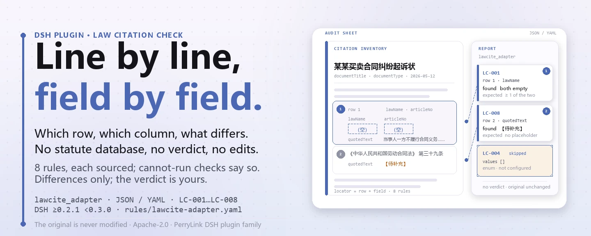

<div align="center">

<picture>
  <source media="(prefers-color-scheme: dark)" srcset="docs/assets/dsh-lawcite-adapter-hero-en-dark.webp">
  
</picture>

# dsh-lawcite-adapter

**कानूनी दस्तावेज़ के हर उद्धरण की जाँच करें — कानून का नाम, धारा संख्या, शब्दशः उद्धरण, प्रभावी स्थिति और दस्तावेज़ के तत्व — और पाएँ कि क्या असंगत है, कहाँ, और कैसे ठीक करें।**

DeepSeek Harness के लिए उद्धरण-जाँच प्लगइन, वकीलों, कानूनी सलाहकारों और दस्तावेज़ प्रारूपकारों के लिए बना: नियम-पैक हर जाँच का आधार लिखता है, केवल शाब्दिक अंतर बताता है, न अनुपालन तय करता है, न उत्तरदायित्व, और मूल दस्तावेज़ को कभी नहीं छूता।

[इंस्टॉल](#तीन-चरणों-में-शुरुआत) · [कॉन्फ़िगरेशन](#कॉन्फ़िगरेशन) · [FAQ](#faq) · [简体中文](README.md) · [English](README.en.md) · [Español](README.es.md) · [Português](README.pt.md) · [हिन्दी](README.hi.md)

[](LICENSE)
[](#संगतता)
[](https://www.npmjs.com/package/dsh-lawcite-adapter)
[](https://github.com/PerryLink/dsh-lawcite-adapter/actions/workflows/ci.yml)
[](#संगतता)

[](https://github.com/PerryLink/dsh-lawcite-adapter/stargazers)
[](https://www.npmjs.com/package/dsh-lawcite-adapter)
[](https://dshfind.com/plugins/PerryLink/dsh-lawcite-adapter?ref=badge)
[](https://securityscorecards.dev/viewer/?uri=github.com/PerryLink/dsh-lawcite-adapter)
[](https://dsh.market/)
[](https://gitee.com/perrylink/dsh-lawcite-adapter)

```sh
dsh plugin --profile <name> add dsh-lawcite-adapter
```

</div>

<sub>सामुदायिक प्लगइन, DeepSeek से असंबद्ध। canonical रिपॉज़िटरी: <https://github.com/PerryLink/dsh-lawcite-adapter> (Gitee एक मिरर है)।</sub>

## यह क्या है

`dsh-lawcite-adapter` एक उद्धरण सूची पढ़ता है — दस्तावेज़ का शीर्षलेख और प्रत्येक उद्धरण के लिए एक पंक्ति — और वह जाँचता है जो इस सूची से यंत्रवत् अपेक्षित किया जा सकता है: क्या हर उद्धरण में कानून का नाम और धारा संख्या लिखी है, क्या धारा संख्या चीनी रूप में है, क्या शब्दशः उद्धरण अपने कॉलम में उतारा गया है, क्या प्रभावी स्थिति आपकी अपनी शब्दावली से है, क्या उद्धरण बताता है कि वह कहाँ प्रयुक्त है और क्या सिद्ध करता है, क्या शीर्षलेख दस्तावेज़ का शीर्षक और प्रकार बताता है, क्या उद्धरण संख्याएँ दोहराई नहीं गई हैं, और क्या उद्धरण कॉलम में कोई अपरिवर्तित टेम्पलेट चिह्न बचा है। आप मूल सामग्री सौंपते हैं (तालिका, सूची या दस्तावेज़; Excel को पहले JSON/YAML में बदला जा सकता है, प्लेटफ़ॉर्म समर्थन करे तो चैट में भी) और आपको «कौन-सी पंक्ति, कौन-सा कॉलम, क्या कम है» की सूची मिलती है। यह यह सत्यापित नहीं करता कि कोई कानून मौजूद है, वर्तमान में प्रभावी है, संशोधित या निरसित नहीं हुआ, या मामले पर लागू होता है। यह अनुपालन नहीं तय करता, उत्तरदायित्व नहीं ठहराता, समीक्षक की जगह नहीं लेता — और मूल को कभी संशोधित नहीं करता।

<picture>
  <source media="(prefers-color-scheme: dark)" srcset="docs/assets/dsh-lawcite-adapter-flow-v5-dark.svg">
  
</picture>

## तीन चरणों में शुरुआत

1. **इंस्टॉल करें**:

   ```sh
   dsh plugin --profile <name> add dsh-lawcite-adapter
   ```

   वैकल्पिक रूप से WorkBuddy / Coze में «Documents and Governance Check Suite» खोजें (पूरा सेट; यह जाँच उसका एक भाग है; उपलब्धता कैटलॉग के अनुसार)।

2. **न्यूनतम कॉन्फ़िगरेशन** (डिफ़ॉल्ट से ही चलता है):

   ```yaml
   - insert:
       - id: dsh-lawcite-adapter
         name: dsh-lawcite-adapter
   ```

   सभी समायोज्य विकल्प `src/config.ts` के Schemastery schema में हैं और डिफ़ॉल्ट तैयार हैं; प्रत्येक नियम की सीमाएँ `rules/` के नियम-पैक में हैं।

3. **जाँचें कि यह माउंट हुआ**:

   ```sh
   dsh --profile <name> --dump-config | grep 'dsh-lawcite-adapter'
   ```

   फिर साथ दिया नमूना चलाएँ (लगभग एक मिनट):

   ```sh
   node samples/quickstart/run.mjs --check
   ```

   नमूना इनपुट `samples/quickstart/input/` में, अपेक्षित आउटपुट `samples/quickstart/expected/result.json` में, और चलाने का स्क्रीनशॉट `docs/assets/quickstart.png` में है।

**अनइंस्टॉल**: `dsh plugin --profile <name> remove dsh-lawcite-adapter` (या प्रोफ़ाइल पैच से वह पंक्ति हटा दें)।

<details>
<summary>DSH Desktop मार्केट से इंस्टॉल करें</summary>

सभी PerryLink प्लगइन DSH Desktop के अंतर्निहित मार्केट में उपलब्ध हैं: **मार्केट → स्रोत → स्रोत जोड़ें → चिपकाएँ** `https://perrylink-dsh-catalog.perrylink.workers.dev/catalog-source.json` **→ चुनें**। इंस्टॉल अब भी मार्केट की npm पहचान-जाँच और आपकी पुष्टि से होता है।

</details>

## मुख्य क्षमताएँ

प्लगइन `lawcite_adapter` टूल पंजीकृत करता है: एक उद्धरण सूची (शीर्षलेख और प्रत्येक उद्धरण की एक पंक्ति) पढ़ता है, संस्करण-बद्ध नियम-पैक लागू करता है, और संरचित रिपोर्ट लौटाता है।

- **नियम-पैक डेटा है, कोड नहीं** — हर नियम `rules/lawcite-adapter.yaml` में है; फ़ाइल बदलने से नियम-समूह बदल जाता है, TypeScript को छूने की ज़रूरत नहीं, और पैक लोड पर सत्यापित होता है, मान लिया नहीं जाता।
- **गंभीरता प्रमाण के अनुसार** — संस्था के अपने कॉन्फ़िगरेशन (`institutional-configuration`) पर टिका नियम अधिकतम `info`; सामान्य सिद्धांत (`derived-from-principle`) पर टिका नियम अधिकतम `warn`; किसी को भी `error` नहीं ठहराया जा सकता (एक टेस्ट इसकी पुष्टि करता है)। वर्तमान आठों नियम `institutional-configuration` पर `info` हैं।
- **खाली सूची कभी «सब ठीक» नहीं** — जो जाँच नहीं चल सकी वह `skipped` में अपना कारण बताती है, और जिस नियम की आवश्यक सूची सेट नहीं है वह चुपचाप पास होने के बजाय `skipped` में खुद को दर्ज करता है (`LC-004` की `values` खाली आती है)।
- **कोई निर्णय नहीं** — रिपोर्ट केवल अंतर गिनाती है, अनुपालन, उत्तरदायित्व या सही-गलत पर कभी फ़ैसला नहीं देती; एक शब्द-संरक्षक रिपोर्ट पर अस्वीकरण हमेशा रखवाता है।
- **आधार जैसा मिला वैसा** — हर नियम में दस्तावेज़, संख्या, धारा का विवरण, शब्दशः अंश और पढ़ने का URL होता है; अंश वास्तविक उद्धरण और कम से कम आठ अक्षर का होना चाहिए। जब शब्दशः पाठ नहीं मिला, अंश स्वयं यह कहता है और नियम को सिद्धांत-व्युत्पन्न या संस्था-कॉन्फ़िगर कहा जाता है — भावानुवाद को कभी उद्धरण बताकर प्रस्तुत नहीं किया जाता।

```text
उद्धरण सूची (शीर्षलेख · प्रत्येक उद्धरण की एक पंक्ति) ──lawcite_adapter──▶ नियम-पैक LC-001…LC-008 ──▶ रिपोर्ट (findings + skipped)
        ▲                                                                                                    │
        └────────────────────────────────── मूल दस्तावेज़ कभी नहीं बदलता ───────────────────────────────────┘
```

### नियम एक नज़र में

| नियम | क्या जाँचता है | गंभीरता | आधार प्रकार |
|---|---|---|---|
| `LC-001` | कानून का नाम और धारा संख्या लिखी है | info | स्थानीय |
| `LC-002` | धारा संख्या चीनी रूप में है | info | स्थानीय |
| `LC-003` | शब्दशः उद्धरण उतारा गया है | info | स्थानीय |
| `LC-004` | प्रभावी स्थिति आपकी शब्दावली से है (डिफ़ॉल्ट रूप से बंद) | info | स्थानीय |
| `LC-005` | उद्धरण अपनी जगह और तर्क-भूमिका बताता है | info | स्थानीय |
| `LC-006` | दस्तावेज़ अपना शीर्षक और प्रकार बताता है | info | स्थानीय |
| `LC-007` | उद्धरण संख्याएँ अद्वितीय हैं | info | स्थानीय |
| `LC-008` | उद्धरण कॉलम में अपरिवर्तित चिह्न नहीं बचा | info | स्थानीय |

`LC-004` की मान-सूची खाली आती है, इसलिए कॉन्फ़िगर करने तक वह `skipped` में खुद को दर्ज करता है: चुपचाप कभी पास नहीं होता।

### उदाहरण

ये प्लगइन के वास्तविक प्रवेश-बिंदु हैं; एक बार इंस्टॉल करें, फिर एक कॉल करें।

**विस्तृत आउटपुट** — टूल `lawcite_adapter`, इनपुट:

```json
{"documentTitle":"某某买卖合同纠纷起诉状","documentType":"民事起诉状","rows":[{"法律法规名称":"","条号":"","引用原文":"当事人一方不履行合同义务或者履行合同义务不符合约定的，应当承担继续履行、采取补救措施或者赔偿损失等违约责任。"}]}
```

आउटपुट:

```json
{
  "id": "dsh-lawcite-adapter.LC-001.de09b5a6",
  "ruleId": "LC-001",
  "severity": "info",
  "locator": {
    "row": 1,
    "field": "lawName"
  },
  "found": "第 1 行 lawName、articleNo 都为空",
  "expected": "lawName、articleNo 至少应填写一项"
}
```

*Observed from `dsh-lawcite-adapter/tests/fixtures/LC-001/LC-001-unsafe.json`*

यह प्लगइन के अपने `LC-001` fixture के लिए **वास्तविक आउटपुट** है, कोई चित्रण नहीं। नियम-पैक कभी उद्धरण नहीं गढ़ता, इसलिए हर निष्कर्ष यह भी बताता है कि पाठ किस आधार से पढ़ा गया और यह कि उस आधार का पाठ इस दौर में नहीं मिला।

### यह किन सवालों का जवाब देता है

| आप पूछते हैं | यह क्या उत्तर देता है |
|---|---|
| किसी पंक्ति में धारा संख्या है पर कानून का नाम खाली है। क्या यह दर्ज होगा? | हाँ। `LC-001` हर पंक्ति में कानून का नाम और धारा संख्या (`lawName`, `articleNo`) अपेक्षित करता है और जिस पंक्ति में इनमें से कोई खाली हो उसे दर्ज करता है। यह जाँचता है कि लिखा गया है या नहीं, यह नहीं कि कानून या धारा मौजूद है: इसमें कोई कानून-डेटाबेस नहीं है और न ही कोई क्वेरी होती है। |
| धारा संख्या के बीच में स्पेस है, या उसके साथ पैराग्राफ़ संख्या जोड़ी गई है। क्या यह पास होगा? | `LC-002` `articleNo` को «सामग्री प्रारूप» में लिखे एंकरित पैटर्न से मिलाता है, इसलिए स्पेस वाला रूप और मिश्रित रूप दोनों दर्ज होते हैं। यह केवल संख्या का रूप जाँचता है, धारा के अस्तित्व पर कुछ नहीं; पैराग्राफ़ और उप-मद अपने अलग कॉलम में जाते हैं, इसलिए धारा कॉलम में केवल धारा वाला भाग रहता है। `pattern` आपकी संस्था की शैली के अनुसार बदला जा सकता है। |
| एक पंक्ति का उद्धरण कॉलम खाली है और दूसरी में अब भी टेम्पलेट चिह्न है। क्या दोनों पकड़े जाते हैं? | हाँ, दो नियमों से। `LC-003` हर पंक्ति में `quotedText` उतारे जाने की अपेक्षा करता है; `LC-008` उस पंक्ति को दर्ज करता है जिसके `quotedText` में अब भी टेम्पलेट शब्द है (फ़ैक्टरी सूची में टेम्पलेट कोष्ठक और ब्रेस, एक x-चिह्न, और सामान्य «भरें» संकेत हैं; सटीक सूची नियम-पैक में लिखी है)। दोनों में से कोई पाठ की तुलना कानून से नहीं करता: `LC-003` देखता है कि उद्धरण मौजूद है, `LC-008` केवल यह कि कोई चिह्न नहीं बचा। संक्षेपण-चिह्न जानबूझकर सूची में नहीं है, इसलिए लंबे उद्धरण का सामान्य संक्षेपण पास होता है। |
| रिपोर्ट में `LC-004` पास होने के बजाय `skipped` दिखता है। क्यों? | क्योंकि `LC-004` की `values` सूची खाली आती है, अर्थात् प्रभावी स्थिति की शब्दावली कॉन्फ़िगर नहीं है, इसलिए नियम चुपचाप पास होने के बजाय `skipped` में खुद को दर्ज करता है। `values` में अपनी शब्दावली भरें (जैसे प्रभावी, संशोधित, निरसित के स्थानीय शब्द) और फिर `LC-004` जाँचेगा कि `effectiveStatus` उस सूची में है। यह आपकी सूची में सदस्यता जाँचता है, यह नहीं कि दर्ज स्थिति तथ्यों से मेल खाती है। |
| पंक्तियाँ कानून का नाम और उद्धरण देती हैं, पर यह नहीं बतातीं कि उद्धरण कहाँ प्रयुक्त है या क्या सिद्ध करता है, और शीर्षलेख में दस्तावेज़ प्रकार नहीं है। क्या यह दर्ज होगा? | हाँ। `LC-005` हर उद्धरण पंक्ति में `usage` और `purpose` अपेक्षित करता है और जिस पंक्ति में दोनों खाली हों उसे दर्ज करता है; यह नहीं आँकता कि उद्धरण वास्तव में उस तर्क का समर्थन करता है। `LC-006` शीर्षलेख से `documentTitle` और `documentType` अपेक्षित करता है, और यह नहीं आँकता कि प्रकार सही चुना गया। |
| वही धारा दो अनुभागों में उद्धृत है और दोनों पंक्तियों में उद्धरण संख्या 3 है। क्या यह निष्कर्ष है? | हाँ। `LC-007` सूची के भीतर दोहराई गई `citationNo` दर्ज करता है, क्योंकि दोहरी संख्या से फ़ुटनोट हर उद्धरण को अलग नहीं पहचान पाते। एक ही प्रावधान का कई अनुभागों में उद्धरण सामान्य है: हर उद्धरण को अपनी संख्या दें। नियम यह नहीं आँकता कि उसी प्रावधान को दो बार उद्धृत करना उचित है। |

## कॉन्फ़िगरेशन

सभी समायोज्य विकल्प `src/config.ts` के Schemastery schema में हैं, इसलिए `cordis.yml` से बदले जा सकते हैं, कोड संपादित करने की ज़रूरत नहीं; प्रत्येक नियम की सीमाएँ `rules/` के नियम-पैक में हैं। नीचे की पाँच कुंजियाँ पूरी सूची हैं; नियम-स्तरीय विकल्प उसके बाद हैं।

| कुंजी | प्रकार | डिफ़ॉल्ट | विवरण |
|---|---|---|---|
| `rulesFile` | string | `rules/lawcite-adapter.yaml` | नियम-पैक का पथ, पैकेज रूट के सापेक्ष |
| `disabledRules` | string[] | `[]` | जिन नियम ids को बंद करना है; हर एक `skipped` में दिखेगा |
| `onlyRules` | string[] | `[]` | केवल ये नियम ids चलाएँ; खाली का अर्थ सभी नियम |
| `skipNotes` | string | `""` | हर `skipped` कारण के साथ जोड़ा जाने वाला नोट |
| `timeoutMs` | number | `120000` | टूल का सहयोगी टाइमआउट बजट |

जानने योग्य नियम-स्तरीय विकल्प:

- `LC-002` `pattern` — धारा संख्या का रूप: डिफ़ॉल्ट रूप से धारा-चिह्न के साथ चीनी या अरबी अंक और वैकल्पिक उप-धारा प्रत्यय। यदि आपकी संस्था की शैली संख्याएँ अलग लिखती है तो इसे बदलें।
- `LC-004` `values` — आपकी प्रभावी-स्थिति शब्दावली, जैसे `[प्रभावी, संशोधित, निरसित, अभी प्रभावी नहीं]`। खाली का अर्थ कोई जाँच नहीं, और किसी कानून की वर्तमान स्थिति भी अंतर्निहित नहीं है।
- `LC-008` `terms` — जो चिह्न खोजने हैं। संक्षेपण-चिह्न जानबूझकर नहीं है: लंबे उद्धरण को हल्के चिह्नों से छोटा करना सामान्य तरीका है।

आपके प्रोफ़ाइल पैच में ओवरराइड का उदाहरण:

```yaml
- insert:
    - id: dsh-lawcite-adapter
      name: dsh-lawcite-adapter
      config:
        onlyRules: [LC-001, LC-002, LC-008]
        skipNotes: संस्था की आंतरिक पुस्तिका, 2026 संस्करण
```

## FAQ

<details>
<summary>क्या मेरी सामग्री बदली या कहीं अपलोड की जाती है?</summary>

नहीं। टूल केवल आपके दिए JSON/YAML पाठ को पढ़ता है और **मूल को कभी संशोधित नहीं करता**; प्लगइन शुद्ध ESM है, इसमें कोई native कोड नहीं, **कोई नेटवर्क नहीं और कोई मॉडल कॉल नहीं** (देखें «संगतता»), इसलिए सामग्री आपकी मशीन से बाहर नहीं जाती।

</details>

<details>
<summary>प्रभावी-स्थिति शब्दावली सेट न हो तो क्या कुछ चुपचाप पास हो जाता है?</summary>

नहीं। `LC-004` की `values` खाली आती है, और जिस नियम की सूची सेट नहीं है वह कारण के साथ `skipped` में खुद को दर्ज करता है, इसलिए खाली अंतर-सूची को कभी «कुछ कम नहीं» नहीं पढ़ा जाता। भरने के बाद नियम केवल यह जाँचता है कि दर्ज मान आपकी सूची में है, यह नहीं कि वह तथ्यों से मेल खाता है।

</details>

<details>
<summary>क्या यह सत्यापित कर सकता है कि कोई कानून मौजूद है या प्रभावी है?</summary>

नहीं। प्लगइन में कोई कानून-डेटाबेस नहीं है और न ही कोई क्वेरी; यह जाँचता है कि उद्धरण ने सत्यापन के लिए आवश्यक तत्व छोड़े या नहीं — कानून, धारा, उद्धरण, प्रभावी स्थिति और प्रयोजन। यह पुष्टि करना कि कोई कानून या धारा मौजूद है, प्रभावी है, या संशोधित या निरसित नहीं हुआ, राष्ट्रीय कानून-विनियम डेटाबेस और मामले के तथ्यों की माँग करता है, जो कानूनी पेशेवर का काम है। देखें «यह किन मानकों पर आधारित है»।

</details>

<details>
<summary>प्लगइन इंस्टॉल होता है पर टूल दिखता ही नहीं। अब क्या?</summary>

जाँचें कि `main` `lib/index.mjs` पर जाता है और `pnpm run build` ने उसे बनाया है; गलत `main` से लोडर उस प्रविष्टि को चुपचाप छोड़ देता है।

</details>

<details>
<summary>एक लंबा दस्तावेज़ या पूरी डायरेक्टरी बैच में चल सकती है?</summary>

टूल `native` और `ptc` दोनों मोड में चलता है; डायरेक्टरी पर बैच के लिए `ptc` चुनें, जिससे schema की लागत एक बार ही देनी पड़े। सारा गणित इनपुट स्ट्रिंग पर wall-clock है, कोई टाइमज़ोन रूपांतरण नहीं।

</details>

## यह किन मानकों पर आधारित है

नियम-पैक हर जाँच का आधार लिखता है। तालिका वे दस्तावेज़ और संख्याएँ दिखाती है जो आठों नियम अभी वहन करते हैं; सभी आधार संस्था-कॉन्फ़िगर हैं और सभी नियम `info` पर हैं।

| दस्तावेज़ | संख्या | इन नियमों द्वारा उद्धृत |
|---|---|---|
| संस्था का कानूनी दस्तावेज़ समीक्षा मानक (संस्था-कॉन्फ़िगर) — पहले विधान कानून (Legislation Law) से जुड़ा था; सत्यापित कि उसका अनुच्छेद 65 विधायी-तकनीक धारा है | कोई एकरूप मानक नहीं (आधार संस्था का अपना उद्धरण-प्रबंधन मानक है) — विधान कानून के 2023 द्वितीय संशोधन का पाठ सत्यापित, और यह नियम उसे उद्धृत नहीं करता | LC-001 |
| संस्था का कानूनी दस्तावेज़ समीक्षा मानक (संस्था-कॉन्फ़िगर) — पहले GB/T 9704—2012 से जुड़ा था, जिसे लेआउट मानक सत्यापित किया गया | GB/T 9704—2012 (इस दौर में धारा-पाठ नहीं मिला) | LC-002, LC-003, LC-005, LC-006, LC-007, LC-008 |
| संस्था के कानूनी दस्तावेज़ समीक्षा उपाय (संस्था-कॉन्फ़िगर) | कोई एकरूप मानक नहीं (आधार संस्था का अपना प्रभावी-स्थिति मानक है) | LC-004 |

उद्धृत दस्तावेज़ों के मूल शीर्षक:

```text
《中华人民共和国立法法》 2023 年第二次修正
《党政机关公文格式》 GB/T 9704—2012
本机构法律文书审查口径（本机构配置）
本机构法律文书审查办法（本机构配置）
```

**सीमा:** यह प्लगइन एक **उद्धरण सूची** की सत्यापन-क्षमता और दस्तावेज़-तत्व जाँचता है — कि हर उद्धरण अपना कानून और धारा बताता है, धारा संख्या चीनी रूप में है, शब्दशः उद्धरण उतारा गया है, प्रभावी स्थिति आपकी शब्दावली से है, उद्धरण बताता है कि वह कहाँ प्रयुक्त है और क्या सिद्ध करता है, दस्तावेज़ अपना शीर्षक और प्रकार बताता है, उद्धरण संख्याएँ अद्वितीय हैं, और कोई चिह्न नहीं बचा। यह **नहीं** सत्यापित करता कि कोई कानून मौजूद है, वर्तमान में प्रभावी है, संशोधित या निरसित नहीं हुआ, या मामले पर लागू होता है।

> ### ⚠️ यह प्लगइन कानून-डेटाबेस नहीं खोजता — और यही मुद्दा है
>
> **यह सबसे गंभीर त्रुटि नहीं पकड़ सकता: ऐसे कानून या धारा का उद्धरण जो मौजूद नहीं या निरसित हो चुका है।** इसकी पुष्टि के लिए राष्ट्रीय कानून-विनियम डेटाबेस और मामले के तथ्य चाहिए, जो कानूनी पेशेवर का काम है। यह प्लगइन यह जाँचता है कि किसी उद्धरण ने सत्यापन के लिए आवश्यक तत्व छोड़े या नहीं — कानून, धारा, उद्धृत पाठ, प्रभावी स्थिति और प्रयोजन।
>
> यह सीमा नियम-पैक के शीर्ष में, `LC-001`, `LC-003` और `LC-004` के नोट में, और समस्या-निवारण अनुभाग में लिखी है। किसी भी निष्कर्ष पर कार्य करने से पहले इसे पढ़ें: **इस प्लगइन की साफ़ रिपोर्ट का अर्थ यह नहीं कि उद्धरण सही हैं।**
>
> `LC-002` धारा संख्या का *रूप* जाँचता है — धारा-चिह्न के साथ चीनी या अरबी अंक और वैकल्पिक उप-धारा प्रत्यय — और धारा के अस्तित्व पर कुछ नहीं। `LC-003` जाँचता है कि उद्धरण उतारा गया, यह नहीं कि उतारा गया पाठ कानून से मेल खाता है। `LC-004` की प्रभावी-स्थिति शब्दावली **खाली** आती है, क्योंकि किसी कानून की वर्तमान स्थिति भी अंतर्निहित नहीं है।
>
> **नियम-पैक का हर `excerpt` स्पष्ट कहता है कि धारा-पाठ इस बार नहीं मिला।** यह व्यवस्था विधान कानून, GB/T 9704—2012 और प्रत्येक संस्था के कानूनी दस्तावेज़ समीक्षा नियमों में है। सत्यापन-दौर शब्दशः धारा-पाठ नहीं ला सका, इसलिए पैक यह अंतर `excerpt` क्षेत्र में ही लिखता है और हर नियम को `warn` या `info` पर रखता है। **पाठ हाथ में आने पर हर `excerpt` को असली धारा से बदलें और `kind` को `direct` तक बढ़ाएँ।**
>
> ⚠️ **एक आधार पूरा नहीं, सुधारा गया।** अध्याय-दर-अध्याय सत्यापित किया गया कि GB/T 9704—2012 एक **लेआउट** मानक है — कागज़, अक्षर-विन्यास, जिल्दसाज़ी, दस्तावेज़-तत्वों की स्थिति और नमूना प्रारूप। **इसमें उद्धरण-प्रबंधन पर कोई प्रावधान नहीं है।** फिर भी छह नियम उस पर टाँगे गए थे («हर उद्धरण में दस्तावेज़ और धारा लिखी हो», «शब्दशः उद्धरण उतारा जाए», आदि)। वे छह अब **संस्था की अपनी कानूनी दस्तावेज़ समीक्षा प्रथा** को आधार घोषित करते हैं, **`institutional-configuration`** हैं, और इसलिए `warn` के बजाय **`info`** पर हैं। उन्हें `warn` पर रखते हुए उनके ही नोट में «इसे संस्था की प्रथा पढ़ें» लिखना स्वयं-विरोधी होता।
>
> **इसके बाद `LC-001` भी उसी तरह सुधारा गया।** यह विधान कानून उद्धृत करता था। वह कानून पूरा मिला और उसमें संख्या-व्यवस्था की एक धारा है — अनुच्छेद 65 कानून को उसकी विषय-वस्तु के अनुसार भाग, अध्याय, अनुभाग, अनुच्छेद, पैराग्राफ़, उप-मद और मद में बाँटता है, संख्या-नियम देता है, और राष्ट्रीय जन-कांग्रेस की स्थायी समिति के कार्य-निकाय को विधायी-तकनीक नियम बनाने का अधिकार देता है। पर वह इस बात को नियंत्रित करता है कि **कोई कानून स्वयं कैसे लिखा और क्रमांकित होता है**; यह नहीं बताता कि कोई सरकारी दस्तावेज़ किसी मौजूद कानून को कैसे उद्धृत करे। इसलिए `LC-001` बाकी सात के साथ जुड़ता है: **इस पैक के सभी आठ नियम अब संस्था की अपनी समीक्षा प्रथा को आधार घोषित करते हैं और `institutional-configuration` पर `info` हैं।** देखें `rules/evidence/clause-verification-basis-mismatch.md`।

## सामग्री प्रारूप

टूल JSON या YAML स्वीकार करता है:

```yaml
documentTitle: 某某买卖合同纠纷起诉状
documentType: 民事起诉状
author: 王律师
draftedAt: 2026-05-12
rows:
  - { 序号: '1', 法律法规名称: 《中华人民共和国民法典》, 条号: 第五百七十七条,
      引用原文: 当事人一方不履行合同义务或者履行合同义务不符合约定的，应当承担继续履行、采取补救措施或者赔偿损失等违约责任。,
      引用位置: 第 2 部分 诉讼请求的事实与理由（第三段）,
      论证作用: 作为被告违约责任请求权的法律依据,
      效力状态: 现行有效, 版本说明: 2020 年 5 月 28 日通过，2021 年 1 月 1 日施行, 引用格式: 脚注① }
```

कॉलम नाम बड़े-छोटे अक्षरों का भेद किए बिना, और स्पेस, अंडरस्कोर व हाइफ़न छोड़कर मिलाए जाते हैं; सूची के अपने कॉलम नाम सुरक्षित रहते हैं, इसलिए निष्कर्ष उसी कॉलम का नाम बताता है जिसे पढ़ा गया। धारा संख्याओं में चीनी या अरबी अंक चलते हैं; स्पेस वाला अरबी रूप दर्ज होता है ताकि संस्था की शैली एक-सी रहे:

```text
LC-002 पैटर्न (डिफ़ॉल्ट): ^第[〇零一二三四五六七八九十百千0-9]+条(之[一二三四五六七八九十]+)?$

第577条          ✓ LC-002 पास
第12条之一        ✓ LC-002 पास
第 577 条        ✗ दर्ज: धारा संख्या में स्पेस है
第12条第3款       ✗ दर्ज: धारा कॉलम में 第12条 रखें, पैराग्राफ़ अलग कॉलम में
```

शीर्षलेख क्षेत्र (`documentTitle`, `documentType`, `author`, `draftedAt` आदि) पठन-परत पर वैकल्पिक हैं और जाँच-इंजन उन्हें सत्यापित करता है, इसलिए आधा निर्यातित सामग्री टूल को रोकने के बजाय «क्षेत्र अनुपस्थित» प्रकार के अंतर पैदा करता है।

## नियमों के स्रोत

नियमों का डेटा `rules/lawcite-adapter.yaml` में है, कोड से अलग। हर नियम में दस्तावेज़, संख्या, स्रोत की अपनी क्रम-प्रणाली में वर्णित धारा, शब्दशः अंश और पढ़ने का URL है। लोडर अनिवार्य करता है कि अंश वास्तविक उद्धरण और कम से कम आठ अक्षर का हो, और सामान्य सिद्धांत (`derived-from-principle`, अधिकतम `warn`) या स्थानीय नीति (`institutional-configuration`, अधिकतम `info`) पर टिकी जाँच को **कभी** `error` नहीं ठहराया जा सकता। जो पैक अपने आधार को बढ़ा-चढ़ाकर बताता है वह भरोसेमंद दिखने वाली रिपोर्ट देने के बजाय लोड पर ही विफल होता है।

⚠️ इस पैक का हर अंश कहता है कि धारा-पाठ नहीं मिला: सत्यापन-दौर शब्दशः पाठ नहीं ला सका, इसलिए सभी आठ नियम संस्था के अपने समीक्षा मानक पर टिके हैं, `institutional-configuration` हैं और `info` पर हैं। **यह अपेक्षा को कमज़ोर करना नहीं — यह ऐसे दस्तावेज़ पर भार दर्ज करने से इनकार है जो उसे वहन नहीं करता।**

धारा-सत्यापन की पूरी रिपोर्ट — GB/T 9704—2012 के दायरे की अध्याय-दर-अध्याय सूची, जाँचे और छोड़े गए स्रोत, और «आधार वस्तु से मेल नहीं खाता» निष्कर्ष — `rules/evidence/clause-verification-basis-mismatch.md` में है।

## संगतता

| सतह | स्थिति |
|---|---|
| Harness | Peer रेंज `>=0.1.2-rc.1 <0.2.0 \|\| >=0.2.0-0 <0.3.0` — सत्यापित कि `0.2.0-rc.2` और `0.2.1-rc.2` दोनों स्वीकार करता है। `engines.dsh` `>=0.2.1-0 <0.3.0` घोषित है और 0.2.1 से होस्ट इसे लागू करता है |
| Node | `^22.19.0 \|\| >=24.0.0` |
| प्लेटफ़ॉर्म | सभी (शुद्ध ESM; कोई native कोड नहीं, कोई नेटवर्क नहीं, कोई मॉडल कॉल नहीं) |
| टूल मोड | `native` और `ptc` दोनों में; डायरेक्टरी पर बैच के लिए `ptc` |

## समस्या निवारण

- **निरसित कानून के उद्धरण को पास कर दिया।** डिज़ाइन से: यह देखता है कि उद्धरण *सत्यापन-योग्य* है, कभी यह नहीं कि वह *सही* है। सत्यापन के लिए राष्ट्रीय डेटाबेस चाहिए, जिसे प्लगइन नहीं खोजता।
- **`LC-003` ऐसा उद्धरण पास कर गया जो कानून से मेल नहीं खाता।** यह देखता है कि उद्धरण *मौजूद* है। कानून से तुलना वह सत्यापन-चरण है जो यह जानबूझकर छोड़ता है।
- **`LC-002` मेरी मान्य शैली पर चेतावनी देता है।** `pattern` को अपनी शैली के अनुसार बदलें। यहाँ पैराग्राफ़ और उप-मद अलग कॉलम में हैं, इसलिए मिश्रित मान में धारा वाला भाग ही धारा कॉलम में रखें।
- **`LC-004` कभी नहीं चलता।** उसकी शब्दावली खाली है और किसी कानून की स्थिति अंतर्निहित नहीं है।
- **`LC-007` उसी धारा के दो बार उद्धृत होने पर चेतावनी देता है।** एक ही प्रावधान का कई अनुभागों में उद्धरण सामान्य है — हर उद्धरण को अपनी संख्या दें, वरना फ़ुटनोट उन्हें अलग नहीं पहचान पाएँगे।
- **कोई नियम नहीं चला।** `skipped` सरणी देखें: वह नियम id और कारण बताती है।
- **पाठक सामग्री अस्वीकार करता है।** उसे कोई भी ज्ञात उद्धरण-कॉलम (कानून का नाम, धारा संख्या, उद्धरण) नहीं मिला; «सामग्री प्रारूप» के अनुसार भरें और फिर चलाएँ।
- **प्लगइन इंस्टॉल होता है पर टूल दिखता ही नहीं।** जाँचें कि `main` `lib/index.mjs` पर जाता है और `pnpm run build` ने उसे बनाया है; गलत `main` से लोडर उस प्रविष्टि को चुपचाप छोड़ देता है।
- **`dsh plugin add` पैकेज को असंगत कहकर अस्वीकार करता है।** Peer रेंज `0.1.x` और `0.2.x` को समेटती है; यदि आपका रनटाइम उससे बाहर है, तो स्पष्ट छूट दें: `dsh plugin --profile <name> allow-version dsh-lawcite-adapter@0.1.0 --dsh-version <runtime> --accept-risk`
- **`check` में `manifest-peers` विफल आता है।** स्थिर जाँचकर्ता 0.2 पंक्ति से पहले की कठोर-कोडित peer रेंज से तुलना करता है। रनटाइम इंस्टॉल के समय peer संगतता लागू करता है, इसलिए घोषित रेंज ही सही है; यह `dsh-plugin-dev` की ज्ञात अपस्ट्रीम समस्या है।
- **समय खिसका हुआ लगता है।** सारा गणित इनपुट स्ट्रिंग पर wall-clock है, कोई टाइमज़ोन रूपांतरण नहीं।

## इकोसिस्टम और गुणवत्ता

- [Gitee मिरर](https://gitee.com/perrylink/dsh-lawcite-adapter) (समकालिक मिरर; GitHub ही मानक है)
- [dshfind प्लगइन पेज](https://dshfind.com/plugins/PerryLink/dsh-lawcite-adapter) (इंस्टॉल और रैंकिंग)
- [OpenSSF Scorecard रिपोर्ट](https://securityscorecards.dev/viewer/?uri=github.com/PerryLink/dsh-lawcite-adapter) ([.github/workflows/scorecard.yml](.github/workflows/scorecard.yml) द्वारा संचालित)
- [DSH Market](https://dsh.market/) (सूचीबद्ध)
- [इकोसिस्टम ज्ञान-कोश — सामग्री के अनुसार जाँचकर्ता चुनें](https://perrylink.github.io/zh/checkers/choose/) (पूरा परिवार सूचकांक: 62 जाँचकर्ता + सामान्य प्लगइन)

## डेवलपमेंट

```sh
pnpm install
pnpm run typecheck   # tsc --noEmit
pnpm test            # vitest, प्रत्येक नियम के जोड़ीदार फ़िक्स्चर (tests/fixtures/<RULE>/)
pnpm run build       # tsdown -> lib/index.mjs + lib/index.d.mts
pnpm run check:readmes   # पाँच भाषाओं के README की एकरूपता
node ../scripts/sync-shared.mjs dsh-lawcite-adapter   # ../_shared से src/shared ताज़ा करें
```

प्लगइन डेटा-चालित है: `src/model.ts` तालिका का आकार घोषित करता है, साझा किट पाठक और जाँच-इंजन देता है, और नियम-पैक हर जाँच घोषित करता है। नियम-पैक डेटा है, कोड नहीं: `rules/*.yaml` बदलने से नियम-समूह बदल जाता है, TypeScript छूने की ज़रूरत नहीं; पैक लोड पर सत्यापित होता है, मान लिया नहीं जाता। README की छवियाँ [`scripts/gen-readme-assets.py`](scripts/gen-readme-assets.py) (Python + Pillow) से क्रमादेशित रूप से बनती हैं: hero चार webp फ़ाइलों का सेट है (zh/en × हल्का/गहरा), और संरचना-चित्र हाथ से लिखा SVG है (हल्का + गहरा, फ़ील्ड × नियम स्तंभ-मानचित्र)।

Topics: `dsh`, `dsh-plugin`, `deepseek-harness`, `cordis`, `lawcite`

## परिवार और आभार

यह परियोजना [PerryLink](https://github.com/PerryLink) द्वारा अनुरक्षित DeepSeek Harness प्लगइन परिवार का हिस्सा है (सभी Apache-2.0)। अगर यह प्लगइन उपयोगी है, तो **एक स्टार** कुछ अनलॉक नहीं करता, पर अगले व्यक्ति को इसे ढूँढना आसान बनाता है।

- [@PerryLink](https://github.com/PerryLink) — निर्माता और अनुरक्षक: `lawcite_adapter` टूल, हर जाँच का आधार लिखने वाला नियम-पैक और उसका धारा-सत्यापन रिकॉर्ड, और पाँच भाषाओं का दस्तावेज़ीकरण।

<details>
<summary>सभी प्लगइन देखें</summary>

| प्लगइन | स्थिति |
|---|---|
| **[dsh-aqua-input-check](https://github.com/PerryLink/dsh-aqua-input-check)** |  |
| **[dsh-archive-check](https://github.com/PerryLink/dsh-archive-check)** |  |
| **[dsh-auto-review](https://github.com/PerryLink/dsh-auto-review)** |  |
| **[dsh-autotier](https://github.com/PerryLink/dsh-autotier)** | 🧊 फ़्रोज़न — रेपो README देखें |
| **[dsh-bid-ca-precheck](https://github.com/PerryLink/dsh-bid-ca-precheck)** |  |
| **[dsh-bid-qual-check](https://github.com/PerryLink/dsh-bid-qual-check)** |  |
| **[dsh-cert-mcp](https://github.com/PerryLink/dsh-cert-mcp)** | 🧊 फ़्रोज़न — रेपो README देखें |
| **[dsh-checkpoint-rewind](https://github.com/PerryLink/dsh-checkpoint-rewind)** |  |
| **[dsh-click](https://github.com/PerryLink/dsh-click)** |  |
| **[dsh-composer-history](https://github.com/PerryLink/dsh-composer-history)** |  |
| **[dsh-contract-stance](https://github.com/PerryLink/dsh-contract-stance)** |  |
| **[dsh-customs-doc-check](https://github.com/PerryLink/dsh-customs-doc-check)** |  |
| **[dsh-data-quality](https://github.com/PerryLink/dsh-data-quality)** | 🧊 फ़्रोज़न — रेपो README देखें |
| **[dsh-demurrage-ledger](https://github.com/PerryLink/dsh-demurrage-ledger)** |  |
| **[dsh-doublecheck](https://github.com/PerryLink/dsh-doublecheck)** |  |
| **[dsh-drill-script-check](https://github.com/PerryLink/dsh-drill-script-check)** |  |
| **[dsh-eia-guide-check](https://github.com/PerryLink/dsh-eia-guide-check)** |  |
| **[dsh-emergency-plan](https://github.com/PerryLink/dsh-emergency-plan)** |  |
| **[dsh-essay-rubric-check](https://github.com/PerryLink/dsh-essay-rubric-check)** |  |
| **[dsh-evidence-check](https://github.com/PerryLink/dsh-evidence-check)** |  |
| **[dsh-export-ctl-check](https://github.com/PerryLink/dsh-export-ctl-check)** |  |
| **[dsh-fast](https://github.com/PerryLink/dsh-fast)** |  |
| **[dsh-fmea-table-check](https://github.com/PerryLink/dsh-fmea-table-check)** |  |
| **[dsh-forecast-penalty](https://github.com/PerryLink/dsh-forecast-penalty)** |  |
| **[dsh-fund-research](https://github.com/PerryLink/dsh-fund-research)** |  |
| **[dsh-github](https://github.com/PerryLink/dsh-github)** |  |
| **[dsh-gongwen-flow-check](https://github.com/PerryLink/dsh-gongwen-flow-check)** |  |
| **[dsh-gongwen-word-check](https://github.com/PerryLink/dsh-gongwen-word-check)** |  |
| **[dsh-guard-plan-qc](https://github.com/PerryLink/dsh-guard-plan-qc)** |  |
| **[dsh-hazchem-check](https://github.com/PerryLink/dsh-hazchem-check)** |  |
| **[dsh-hazplan-check](https://github.com/PerryLink/dsh-hazplan-check)** |  |
| **[dsh-hidden-risk-map](https://github.com/PerryLink/dsh-hidden-risk-map)** |  |
| **[dsh-hs-classify](https://github.com/PerryLink/dsh-hs-classify)** |  |
| **[dsh-icd-rule-check](https://github.com/PerryLink/dsh-icd-rule-check)** |  |
| **[dsh-industry-research](https://github.com/PerryLink/dsh-industry-research)** |  |
| **[dsh-lawcite-adapter](https://github.com/PerryLink/dsh-lawcite-adapter)** |  |
| **[dsh-laya](https://github.com/PerryLink/dsh-laya)** |  |
| **[dsh-lc-doc-check](https://github.com/PerryLink/dsh-lc-doc-check)** |  |
| **[dsh-learning-gap-check](https://github.com/PerryLink/dsh-learning-gap-check)** |  |
| **[dsh-library](https://github.com/PerryLink/dsh-library)** |  |
| **[dsh-local-ai](https://github.com/PerryLink/dsh-local-ai)** |  |
| **[dsh-lsp-actions](https://github.com/PerryLink/dsh-lsp-actions)** |  |
| **[dsh-mask](https://github.com/PerryLink/dsh-mask)** |  |
| **[dsh-mcp-panel](https://github.com/PerryLink/dsh-mcp-panel)** |  |
| **[dsh-medrec-qc](https://github.com/PerryLink/dsh-medrec-qc)** |  |
| **[dsh-memento](https://github.com/PerryLink/dsh-memento)** | 🧊 फ़्रोज़न — रेपो README देखें |
| **[dsh-nsfc-form-check](https://github.com/PerryLink/dsh-nsfc-form-check)** |  |
| **[dsh-nurse-record-check](https://github.com/PerryLink/dsh-nurse-record-check)** |  |
| **[dsh-observe](https://github.com/PerryLink/dsh-observe)** |  |
| **[dsh-origin-rvc-check](https://github.com/PerryLink/dsh-origin-rvc-check)** |  |
| **[dsh-ota-review-check](https://github.com/PerryLink/dsh-ota-review-check)** |  |
| **[dsh-output-styles](https://github.com/PerryLink/dsh-output-styles)** |  |
| **[dsh-paper-doc-adapter](https://github.com/PerryLink/dsh-paper-doc-adapter)** |  |
| **[dsh-permission-rules](https://github.com/PerryLink/dsh-permission-rules)** |  |
| **[dsh-permit-report-check](https://github.com/PerryLink/dsh-permit-report-check)** |  |
| **[dsh-pipeline-check](https://github.com/PerryLink/dsh-pipeline-check)** |  |
| **[dsh-pleading-draft](https://github.com/PerryLink/dsh-pleading-draft)** |  |
| **[dsh-plugin-doctor](https://github.com/PerryLink/dsh-plugin-doctor)** | 🚫 रिटायर्ड (रेपो संग्रहीत) |
| **[dsh-plugin-guide](https://github.com/PerryLink/dsh-plugin-guide)** |  |
| **[dsh-plugin-kit](https://github.com/PerryLink/dsh-plugin-kit)** | 🚫 रिटायर्ड (रेपो संग्रहीत) |
| **[dsh-plugin-upgrade](https://github.com/PerryLink/dsh-plugin-upgrade)** | 🚫 रिटायर्ड (रेपो संग्रहीत) |
| **[dsh-policy-brief-draft](https://github.com/PerryLink/dsh-policy-brief-draft)** |  |
| **[dsh-power-loss-split](https://github.com/PerryLink/dsh-power-loss-split)** |  |
| **[dsh-power-ticket-check](https://github.com/PerryLink/dsh-power-ticket-check)** |  |
| **[dsh-ppap-check](https://github.com/PerryLink/dsh-ppap-check)** |  |
| **[dsh-protest-deadline](https://github.com/PerryLink/dsh-protest-deadline)** |  |
| **[dsh-railway-window](https://github.com/PerryLink/dsh-railway-window)** |  |
| **[dsh-repair-order-qc](https://github.com/PerryLink/dsh-repair-order-qc)** |  |
| **[dsh-research-report](https://github.com/PerryLink/dsh-research-report)** |  |
| **[dsh-review-reply-check](https://github.com/PerryLink/dsh-review-reply-check)** |  |
| **[dsh-rulefile-check](https://github.com/PerryLink/dsh-rulefile-check)** |  |
| **[dsh-safety-brief-check](https://github.com/PerryLink/dsh-safety-brief-check)** |  |
| **[dsh-score](https://github.com/PerryLink/dsh-score)** | 🧊 फ़्रोज़न — रेपो README देखें |
| **[dsh-session-sync](https://github.com/PerryLink/dsh-session-sync)** |  |
| **[dsh-site-log-check](https://github.com/PerryLink/dsh-site-log-check)** |  |
| **[dsh-skill-pack-security](https://github.com/PerryLink/dsh-skill-pack-security)** |  |
| **[dsh-soe-decision-check](https://github.com/PerryLink/dsh-soe-decision-check)** |  |
| **[dsh-soilwater-check](https://github.com/PerryLink/dsh-soilwater-check)** |  |
| **[dsh-sop-sync-check](https://github.com/PerryLink/dsh-sop-sync-check)** |  |
| **[dsh-spc-gbt-adapter](https://github.com/PerryLink/dsh-spc-gbt-adapter)** |  |
| **[dsh-talk](https://github.com/PerryLink/dsh-talk)** |  |
| **[dsh-tender-extract](https://github.com/PerryLink/dsh-tender-extract)** |  |
| **[dsh-tender-matrix](https://github.com/PerryLink/dsh-tender-matrix)** |  |
| **[dsh-test-drive](https://github.com/PerryLink/dsh-test-drive)** |  |
| **[dsh-ticktick](https://github.com/PerryLink/dsh-ticktick)** | 🚫 रिटायर्ड (रेपो संग्रहीत) |
| **[dsh-translate](https://github.com/PerryLink/dsh-translate)** |  |
| **[dsh-warranty-calc](https://github.com/PerryLink/dsh-warranty-calc)** |  |
| **[dsh-budget](https://github.com/PerryLink/dsh-budget)** | 🧊 फ़्रोज़न — रेपो README देखें |
| **[dsh-claude-move](https://github.com/PerryLink/dsh-claude-move)** | 🧊 फ़्रोज़न — रेपो README देखें |
| **[dsh-defend](https://github.com/PerryLink/dsh-defend)** | 🧊 फ़्रोज़न — रेपो README देखें |
| **[dsh-draw](https://github.com/PerryLink/dsh-draw)** | 🧊 फ़्रोज़न — रेपो README देखें |
| **[dsh-reach](https://github.com/PerryLink/dsh-reach)** | 🧊 फ़्रोज़न — रेपो README देखें |
| **[dsh-background-agents](https://github.com/PerryLink/dsh-background-agents)** | 🚫 रिटायर्ड (रेपो संग्रहीत) |
| **[dsh-session-pin](https://github.com/PerryLink/dsh-session-pin)** | 🚫 रिटायर्ड (रेपो संग्रहीत) |
| **[dsh-team-rooms](https://github.com/PerryLink/dsh-team-rooms)** | 🚫 रिटायर्ड (रेपो संग्रहीत) |

</details>

## लाइसेंस

[LICENSE](LICENSE) (Apache License 2.0) © 2026 dsh-lawcite-adapter contributors

<p align="center"><sub>Apache-2.0 · सामुदायिक प्लगइन, DeepSeek से असंबद्ध।</sub></p>
