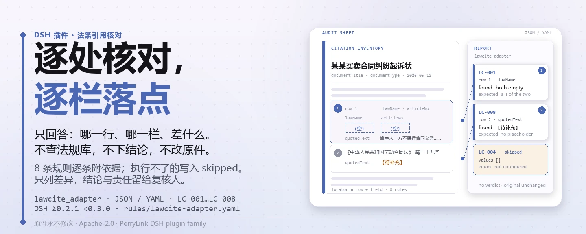

<div align="center">

<picture>
  <source media="(prefers-color-scheme: dark)" srcset="docs/assets/dsh-lawcite-adapter-hero-zh-dark.webp">
  
</picture>

# dsh-lawcite-adapter

**逐处核对法条引用清单的名称、条号、引文、效力状态与文书要素——输出「哪一行、哪一栏、差什么」的清单。**

面向律师、法务与文书起草人的 DeepSeek Harness 检查插件：规则包逐条写明依据来源，只列材料与引用要素之间的字面差异，不下合规结论、不认定责任、不改原件。

[安装](#三步上手) · [配置](#配置) · [FAQ](#faq) · [简体中文](README.md) · [English](README.en.md)

[](LICENSE)
[](#兼容性)
[](https://www.npmjs.com/package/dsh-lawcite-adapter)
[](https://github.com/PerryLink/dsh-lawcite-adapter/actions/workflows/ci.yml)
[](#兼容性)

[](https://github.com/PerryLink/dsh-lawcite-adapter/stargazers)
[](https://www.npmjs.com/package/dsh-lawcite-adapter)
[](https://dshfind.com/plugins/PerryLink/dsh-lawcite-adapter?ref=badge)
[](https://securityscorecards.dev/viewer/?uri=github.com/PerryLink/dsh-lawcite-adapter)
[](https://dsh.market/)
[](https://gitee.com/perrylink/dsh-lawcite-adapter)

```sh
dsh plugin --profile <name> add dsh-lawcite-adapter
```

</div>

<sub>社区插件，与 DeepSeek 官方无关。唯一仓库：<https://github.com/PerryLink/dsh-lawcite-adapter>（Gitee 为镜像）。</sub>

## 它是什么

`dsh-lawcite-adapter` 读取一份法条引用清单——文书表头加每处引用一行——核对这份清单自身可以机械判定的事项：每处引用是否写明法律名称与条号、条号是否写成规范的中文形式、是否抄录了引用原文、效力状态是否取自本机构配置的取值、是否写明引用位置与论证作用、文书表头是否声明标题与文书类型、引用编号是否重复、引用原文栏是否残留未替换的占位符。你交出原始材料（表格、清单或文书；Excel 可先转成 JSON/YAML，对话里也能代转），它返回一份「哪一行、哪一栏、差什么」的差异清单。它不核验法条是否真实存在、是否现行有效、是否已被修订或废止、是否适用于本案；不下合规结论、不认定责任、不替代审核人，也绝不修改原件。

<picture>
  <source media="(prefers-color-scheme: dark)" srcset="docs/assets/dsh-lawcite-adapter-flow-v5-dark.svg">
  
</picture>

## 三步上手

1. **安装**：

   ```sh
   dsh plugin --profile <name> add dsh-lawcite-adapter
   ```

   也可以在 WorkBuddy / 扣子搜「文书与治理核对包」（本检查是其中一项；上架以商城为准）。

2. **最小配置**（默认即可用）：

   ```yaml
   - insert:
       - id: dsh-lawcite-adapter
         name: dsh-lawcite-adapter
   ```

   全部可调项都在 `src/config.ts` 的 Schemastery schema 里，默认值开箱即用；逐条阈值在 `rules/` 下的规则包里。

3. **验证已生效**：

   ```sh
   dsh --profile <name> --dump-config | grep 'dsh-lawcite-adapter'
   ```

   再用自带样例跑一次（约 1 分钟）：

   ```sh
   node samples/quickstart/run.mjs --check
   ```

   样例输入在 `samples/quickstart/input/`，期望输出在 `samples/quickstart/expected/result.json`，运行截图见 `docs/assets/quickstart.png`。

**卸载**：`dsh plugin --profile <name> remove dsh-lawcite-adapter`（或从 profile patch 删掉该行）。

<details>
<summary>从 DSH Desktop 市场安装</summary>

所有 PerryLink 插件均可在 DSH Desktop 内置市场中浏览：**市场 → 来源 → 添加来源 → 粘贴** `https://perrylink-dsh-catalog.perrylink.workers.dev/catalog-source.json` **→ 选中**。安装仍需通过市场的 npm 身份校验与你的确认。

</details>

## 核心能力

本插件注册 `lawcite_adapter` 工具：读入一份法条引用清单（文书表头加每处引用一行），套用带版本的规则包，返回一份结构化报告。

- **规则包即数据** —— 检查规则全部在 `rules/lawcite-adapter.yaml` 里，换规则不动代码；规则包在加载期校验，而非被信任。
- **严重级跟着依据走** —— 依据为本机构配置（`institutional-configuration`）的阈值封顶 `info`；依据为原则性条款（`derived-from-principle`）的封顶 `warn`；绝不会把原则或本地配置标成 `error`（有测试断言）。本规则库 8 条规则当前全部为 `institutional-configuration`、`info`。
- **空清单不等于没问题** —— 每一项无法执行的检查都会在 `skipped` 里自报原因；必填清单未配置的规则自报 `skipped`，而不是静默通过（`LC-004` 的 `values` 出厂为空）。
- **不裁决** —— 报告只列差异，永不判定合规、责任或对错；措辞守卫强制报告始终携带免责声明。
- **依据如实** —— 每条规则带文件名、文号、条款描述、摘录与来源链接；摘录必须是真实引文且不少于八个字符。无法取得逐字原文时在摘录里明说，并把规则标记为推论类或本机构配置，绝不把转述包装成引文。

```text
引用清单（文书表头 · 每处引用一行）──lawcite_adapter──▶ 规则包 LC-001…LC-008 ──▶ 报告（findings + skipped）
        ▲                                                                              │
        └──────────────────────────── 原件永不修改 ────────────────────────────────┘
```

### 规则一览

| 规则 | 核对内容 | 严重级 | 依据类型 |
|---|---|---|---|
| `LC-001` | 每处引用写明法律名称与条号 | info | 本机构配置 |
| `LC-002` | 条号写成规范的中文形式 | info | 本机构配置 |
| `LC-003` | 直接引用抄录原文 | info | 本机构配置 |
| `LC-004` | 效力状态取自本机构口径的取值（默认关闭） | info | 本机构配置 |
| `LC-005` | 每处引用写明引用位置与论证作用 | info | 本机构配置 |
| `LC-006` | 文书声明标题与文书类型 | info | 本机构配置 |
| `LC-007` | 引用编号在清单内唯一 | info | 本机构配置 |
| `LC-008` | 引用原文栏不残留未替换的占位符 | info | 本机构配置 |

`LC-004` 的取值清单出厂为空，配置之前它自报 `skipped`，不会静默通过。

### 示例

以下为插件真实入口；安装后调用一次即可。

**详细输出** — 工具 `lawcite_adapter`，输入：

```json
{"documentTitle":"某某买卖合同纠纷起诉状","documentType":"民事起诉状","rows":[{"法律法规名称":"","条号":"","引用原文":"当事人一方不履行合同义务或者履行合同义务不符合约定的，应当承担继续履行、采取补救措施或者赔偿损失等违约责任。"}]}
```

输出：

```json
{
  "id": "dsh-lawcite-adapter.LC-001.de09b5a6",
  "ruleId": "LC-001",
  "severity": "info",
  "locator": {
    "row": 1,
    "field": "lawName"
  },
  "found": "第 1 行 lawName、articleNo 都为空",
  "expected": "lawName、articleNo 至少应填写一项"
}
```

*Observed from `dsh-lawcite-adapter/tests/fixtures/LC-001/LC-001-unsafe.json`*

本插件对自己 `LC-001` 测试夹具的**真实输出**，不是示意图。规则库不伪造引文，因此每条发现都会同时写明所引依据，以及该依据原文本次未取得。

### 它回答什么问题

| 你会问 | 它怎么答 |
|---|---|
| 某处引用填了条号，法律名称栏却是空的，会被报出吗？ | 会。`LC-001` 要求每处引用都写明法律名称与条号（`lawName`、`articleNo`），缺其一即报出该行。它只核对是否写明，不核验该法律或该条号是否存在——本插件不含法规库，也不查询法规库。 |
| 条号写成 `第 577 条`，或者写成 `第12条第3款`，能通过吗？ | `LC-002` 用 `^第[〇零一二三四五六七八九十百千0-9]+条(之[一二三四五六七八九十]+)?$` 匹配 `articleNo`，因此带空格的 `第 577 条` 与混写的 `第12条第3款` 都会被报出。它只核对条号本身的形式，不核对条号是否存在；款、项应单列一栏，故 `第12条` 填在 `articleNo`。`pattern` 可按本机构口径调整。 |
| 某行的引用原文栏是空的，另一行还写着 `【待补充】`，两种情况都能查出来吗？ | 能，两条规则各管一头。`LC-003` 要求每行都抄录引用原文（`quotedText`）；`LC-008` 报出 `quotedText` 仍含模板用语的行（出厂 `terms` 为 `【`、`】`、`{{`、`}}`、`XXX`、`xxx`、`待填`、`待补充`、`TBD`、`todo`、`示例`）。两条都不与法条原文比对：`LC-003` 只核对是否抄录，`LC-008` 只核对是否残留占位符。`terms` 不含「略」，故 `……（略）` 属于正常省略写法。 |
| 报告里 `LC-004` 显示为 `skipped` 而不是通过，为什么？ | 因为 `LC-004` 的 `values` 出厂为空，表示效力状态口径尚未配置，本条报告「无法执行」而不是静默通过。把 `values` 填成本机构的取值（如 `现行有效`、`已修订`、`已废止`）后，`LC-004` 才核对 `effectiveStatus` 是否在册；在册与否之外，它不核验所填状态是否与事实相符。 |
| 各行写了法律名称也抄了原文，却没写引用位置与论证作用，表头也没写文书类型，会被报出吗？ | 会。`LC-005` 要求每处引用写明引用位置与论证作用（`usage`、`purpose`），两者都空即报出该行；它不判断该引用是否真的支持该论点。`LC-006` 要求表头声明文书标题与文书类型（`documentTitle`、`documentType`），它不判断类型选得对不对。 |
| 同一条法条在两章里各引一次，两行的引用编号都填了 3，会被报出吗？ | 会。`LC-007` 报出清单内重复的引用编号（`citationNo`），因为编号重复会让脚注无法准确定位到具体那处引用。同一法条在不同章节多次引用属于正常情形：给每处引用各自的编号即可。它不判断重复引用同一条法条是否恰当。 |

## 配置

全部可调参数都在 `src/config.ts` 的 Schemastery schema 中，只改 `cordis.yml` 即可生效，无需改代码；逐条阈值在 `rules/` 下的规则库文件里。全部配置键即下表 5 个；规则级参数见表后。

| 键 | 类型 | 默认值 | 说明 |
|---|---|---|---|
| `rulesFile` | string | `rules/lawcite-adapter.yaml` | 规则库文件路径，相对插件包根目录 |
| `disabledRules` | string[] | `[]` | 要停用的规则 id 列表；每条都会出现在 `skipped` 中 |
| `onlyRules` | string[] | `[]` | 只执行这些规则 id；留空表示执行全部规则 |
| `skipNotes` | string | `""` | 附加到每条 `skipped` 说明后的备注 |
| `timeoutMs` | number | `120000` | 工具协作式超时预算（毫秒） |

值得知道的规则级参数：

- `LC-002` `pattern` —— 条号形状，出厂为 `第[〇零一二三四五六七八九十百千0-9]+条` 加可选的 `之一`。本机构另有写法时改这里。
- `LC-004` `values` —— 本机构的效力状态取值，如 `[现行有效, 已修订, 已废止, 尚未生效]`。留空表示不核对，插件也不内置任何法规的效力表。
- `LC-008` `terms` —— 要查找的占位符。出厂**不含**「略」：`……（略）` 是长引文的正常省略写法。

profile patch 覆盖示例：

```yaml
- insert:
    - id: dsh-lawcite-adapter
      name: dsh-lawcite-adapter
      config:
        onlyRules: [LC-001, LC-002, LC-008]
        skipNotes: 本机构实施细则 2026 版
```

## FAQ

<details>
<summary>我的材料会被改动或上传吗？</summary>

不会。工具只读取你交出的 JSON/YAML 材料文本，**绝不修改原件**；插件是纯 ESM、无原生代码、**不联网、不调用模型**（见「兼容性」），材料不离开你的机器。

</details>

<details>
<summary>没配效力状态取值时，会不会静默通过？</summary>

不会。`LC-004` 的 `values` 出厂为空，清单未配置的规则会把自己报进 `skipped` 并写明原因——空的差异清单不会被读成「没有缺项」。填入本机构的取值之后，它只核对所填值是否在册，不核验所填状态是否与事实相符。

</details>

<details>
<summary>它能核验法条是否存在、是否现行有效吗？</summary>

不能。本插件不含法规库、也不查询法规库；它核对的是引用是否留下了可核验的要素——法律、条款、引文、效力状态、用途。确认某部法律或某个条款是否存在、是否现行有效、是否已被修订或废止，需要国家法律法规数据库与案件事实，那是法律专业人员的工作。详见「依据的标准」。

</details>

<details>
<summary>插件装上了但工具不出现，怎么办？</summary>

确认 `main` 指向 `lib/index.mjs` 且 `pnpm run build` 已生成该文件；`main` 写错会让加载器静默跳过该条目。

</details>

<details>
<summary>一整份文书或整个目录批量核，跑得动吗？</summary>

工具在 `native` 与 `ptc` 两种模式下都可用；批量校验整个目录时建议 `ptc`，schema 成本只付一次。全部计算都是对输入字符串做墙上时钟运算，不做时区换算。

</details>

## 依据的标准

规则包为每条检查注明依据。下表是 8 条规则当前所挂的依据文件与文号；依据类型全部为本机构配置，严重级全部为 `info`。

| 文件 | 文号 | 引用它的规则 |
|---|---|---|
| 本机构法律文书审查口径（本机构配置）—— 原挂《中华人民共和国立法法》，已核实其第六十五条为立法技术条款 | 无统一标准（本条依据为本机构配置的引用管理口径）—— ⚠️ 《立法法》2023 年第二次修正文本已核实，本条不引用该法 | LC-001 |
| 本机构法律文书审查口径（本机构配置）—— 原挂《党政机关公文格式》GB/T 9704—2012，已核实为版式标准 | GB/T 9704—2012（本次未取得条文） | LC-002, LC-003, LC-005, LC-006, LC-007, LC-008 |
| 本机构法律文书审查办法（本机构配置） | 无统一标准（本条依据为本机构配置的效力口径） | LC-004 |

**边界：** 本插件核对一份**法条引用清单**的可核验性与文书要素——每条引用是否写明所引法律与条号，条号是否符合中文写法，直接引文是否照录，效力状态是否取自你的取值口径，引用是否写明其使用位置与所主张的内容，文书是否写明标题与文种，引用编号是否唯一，以及是否残留占位符。它**不**核实某部法律是否存在、当前是否有效、是否未经修改或废止，也不核实其是否适用于本案。

> ### ⚠️ 本插件不查询法规数据库——而这正是重点
>
> **它无法发现后果最严重的错误：引用了不存在的、或已被废止的法律或条款。** 确认这一点需要国家法律法规数据库和案件事实，那是法律专业人员的工作。本插件核对的是：一处引注是否遗漏了核验它所需的要素——法律、条款、引文、效力状态和用途。
>
> 这条边界写在规则库库头、`LC-001`、`LC-003` 和 `LC-004` 的说明以及排障一节中。在依据任何发现采取行动之前，请先读它：**本插件给出的一份干净报告，并不等于这些引注就是正确的。**
>
> `LC-002` 核对条款编号的*形式*——中文数字或阿拉伯数字的 `第X条`，允许 `第X条之一`——完全不涉及该条款是否存在。`LC-003` 核对的是引文已逐字录入，而不是录入内容与法规一致。`LC-004` 的效力状态词表出厂为**空**，因为任何法规的现行状态同样没有内置。
>
> **规则库中的每一个 `excerpt` 都明文写着：条款原文本次未取得。** 该制度见于《中华人民共和国立法法》、GB/T 9704—2012 以及各机构自己的法律文件审核规则。核验环节无法取得逐字条款原文，因此规则库在 `excerpt` 字段本身写明这一缺口，并把每条规则保持在 `warn` 或 `info`。**待取得原文后，请把每个 `excerpt` 换成真实条款，并把 `kind` 提到 `direct`。**
>
> ⚠️ **有一项依据是被更正了，而不是被补全了。** 经逐章核验，GB/T 9704—2012《党政机关公文格式》是一部**版面**标准——纸张、排版、装订、公文要素的位置以及式样。**它完全不包含任何关于引注管理的规定。** 但此前仍有六条规则挂在它名下（「每处引注都必须写明文件与条款」「直接引用必须逐字录入」等等）。这六条规则现在改以**机构自身的法律文件审核实践**为依据，评为 **`institutional-configuration`**，因此定在 **`info`** 而不是 `warn`。如果一边把它们留在 `warn`，一边又在它们自己的说明里写着「请按机构实践来读」，那就自相矛盾了。
>
> **随后 `LC-001` 也以同样的方式被更正。** 它原本引用《中华人民共和国立法法》。该法已完整取得，其中确实有一条关于编号的规定——第六十五条：「法律根据内容需要，可以分编、章、节、条、款、项、目」，并附有编号规则，以及授权全国人大常委会工作机构拟订立法技术规范的规定。但该条规范的是**法律本身如何起草和编号**；它完全没有说明一份公文应当如何引用一部现行法律。因此 `LC-001` 加入了另外七条的行列：**本规则库中的全部八条规则现在都以机构自身的审核实践为依据，并评为 `institutional-configuration`，定在 `info`。** 参见 `rules/evidence/clause-verification-basis-mismatch.md`。

## 材料格式

工具接受 JSON 或 YAML：

```yaml
documentTitle: 某某买卖合同纠纷起诉状
documentType: 民事起诉状
author: 王律师
draftedAt: 2026-05-12
rows:
  - { 序号: '1', 法律法规名称: 《中华人民共和国民法典》, 条号: 第五百七十七条,
      引用原文: 当事人一方不履行合同义务或者履行合同义务不符合约定的，应当承担继续履行、采取补救措施或者赔偿损失等违约责任。,
      引用位置: 第 2 部分 诉讼请求的事实与理由（第三段）,
      论证作用: 作为被告违约责任请求权的法律依据,
      效力状态: 现行有效, 版本说明: 2020 年 5 月 28 日通过，2021 年 1 月 1 日施行, 引用格式: 脚注① }
```

栏目名按忽略大小写、空格、下划线与连字符匹配；清单自带的栏目名会保留，因此发现里写的是它实际读过的那一栏。条号可用汉字或阿拉伯数字；带空格的阿拉伯数字写法会被报出，以保持本机构口径一致：

```text
第577条          ✓ 通过 LC-002
第12条之一        ✓ 通过 LC-002
第 577 条        ✗ 报出：条号中带空格
第12条第3款       ✗ 报出：款号应单列一栏，条号栏填 第12条
```

表头字段（`documentTitle`、`documentType`、`author`、`draftedAt` 等）在读取层是可选的，由检查引擎校验，因此部分导出的材料会产生「缺项」类差异，而不是让程序崩溃。

## 规则来源

规则数据在 `rules/lawcite-adapter.yaml`，与代码分离。每条规则携带文件名、文号、按原文自身编号体系的条款描述、逐字摘录与来源链接。加载器强制：摘录必须是真实引文且不少于八个字符；依据仅为一般原则（`derived-from-principle`，严重级上限 `warn`）或本机构配置（`institutional-configuration`，上限 `info`）的检查**永远不能**标为 `error`。夸大依据的规则库会在加载期失败，而不会产出一份看起来很有底气的报告。

⚠️ 本规则库的摘录全部如实写明「该条文本次未取得」：核查未取得这些文件的逐字原文，因此 8 条规则全部以本机构法律文书审查口径为依据，评为 `institutional-configuration`、定为 `info`。**这不代表要求变弱，而是不把分量记到并不承载它的文件上。**

完整的条款核验报告——含逐章枚举 GB/T 9704—2012 的规范范围、经核查后被弃用的来源，以及「依据与核对对象不匹配」的结论——见 `rules/evidence/clause-verification-basis-mismatch.md`。

## 兼容性

| 项目 | 状态 |
|---|---|
| Harness | 对等版本范围 `>=0.1.2-rc.1 <0.2.0 \|\| >=0.2.0-0 <0.3.0` —— 已实测同时接受 `0.2.0-rc.2` 与 `0.2.1-rc.2`。**已声明 `engines.dsh`**：0.2.1 起由宿主单独裁决，范围为 `>=0.2.1-0 <0.3.0` |
| Node | `^22.19.0 \|\| >=24.0.0` |
| 平台 | 全平台（纯 ESM；无原生代码、无联网、不调用模型） |
| 工具模式 | `native` / `ptc` 均可；批量校验整个目录时建议 `ptc`，schema 成本只付一次 |

## 故障排查

- **它放过了一条引用已废止法条的引注。** 设计如此：它核对引用是否*可核验*，从不核对引用是否*正确*。核验正确性需要国家法律法规数据库，本插件不查询。
- **`LC-003` 放过了一条与法条原文不符的引文。** 它只核对引文是否*存在*；与法条原文比对是它刻意省略的核验步骤。
- **`LC-002` 对我认为可以接受的写法报警。** 按本机构口径调整 `pattern`。注意款、项在本模型里单列，`第12条第3款` 应把 `第12条` 填在条号栏。
- **`LC-004` 从不运行。** 它的取值清单为空，且插件不内置任何法规的效力状态。
- **`LC-007` 对同一条法条被引用两次报警。** 同一法条在不同章节多次引用属于正常情形——给每处引用各自的编号，否则脚注无法把它们分开定位。
- **某条规则没有执行。** 查看 `skipped` 数组，其中写明了规则 id 与原因。
- **材料被读取器拒收。** 它没有找到任何已知的引用栏目（法律名称、条号、引用原文等）；按「材料格式」补齐栏目后再跑。
- **插件装上了但工具不出现。** 确认 `main` 指向 `lib/index.mjs` 且 `pnpm run build` 已生成该文件；`main` 写错会让加载器静默跳过该条目。
- **`dsh plugin add` 以不兼容为由拒绝。** peer 范围覆盖 `0.1.x` 与 `0.2.x`；若运行时在其之外，可显式豁免：`dsh plugin --profile <name> allow-version dsh-lawcite-adapter@0.1.0 --dsh-version <runtime> --accept-risk`
- **`check` 报 `manifest-peers` 失败。** 静态检查器比对的是一份早于 0.2 世代的硬编码 peer 范围；安装期的 peer 校验以运行时为准，声明的范围才是正确的。这是 `dsh-plugin-dev` 的已知上游问题。
- **时间看起来偏移。** 全部计算都是对输入字符串做墙上时钟运算，不做时区换算。

## 生态与质量

- [Gitee 镜像](https://gitee.com/perrylink/dsh-lawcite-adapter)（同步镜像，以 GitHub 为准）
- [dshfind 插件页](https://dshfind.com/plugins/PerryLink/dsh-lawcite-adapter)（安装量与排名）
- [OpenSSF Scorecard 报告](https://securityscorecards.dev/viewer/?uri=github.com/PerryLink/dsh-lawcite-adapter)（由 [.github/workflows/scorecard.yml](.github/workflows/scorecard.yml) 驱动）
- [DSH Market](https://dsh.market/)（已上架）
- [生态实测知识库 · 按材料选核查器](https://perrylink.github.io/zh/checkers/choose/)（完整家族清单：62 个核查器 + 通用插件）

## 开发

```sh
pnpm install
pnpm run typecheck   # tsc --noEmit
pnpm test            # vitest，每条规则配对正/反夹具（tests/fixtures/<RULE>/）
pnpm run build       # tsdown -> lib/index.mjs + lib/index.d.mts
pnpm run check:readmes   # 五语 README 一致性
node ../scripts/sync-shared.mjs dsh-lawcite-adapter   # 从 ../_shared 刷新 src/shared
```

插件是数据驱动的：`src/model.ts` 声明表格形态，共享件提供读取器与检查引擎，规则包声明每一条检查。规则包是数据不是代码：改 `rules/*.yaml` 即切换规则集，无需动 TypeScript；规则包在加载期校验，而非被信任。README 配图由 [`scripts/gen-readme-assets.py`](scripts/gen-readme-assets.py) 程序化生成（Python + Pillow）：hero 为 zh/en × 深浅四张 webp 横幅，结构图为手写 SVG（深浅双版，字段 × 规则栏位对照）。

Topics：`dsh`, `dsh-plugin`, `deepseek-harness`, `cordis`, `lawcite`

## 家族与致谢

本项目是 [PerryLink](https://github.com/PerryLink) 维护的 DeepSeek Harness 插件家族成员（全部 Apache-2.0）。如果这个插件帮到了你，**给个 star**——它不解锁任何功能，但会让下一个人更容易找到它。

- [@PerryLink](https://github.com/PerryLink) —— 创建者与维护者：`lawcite_adapter` 工具、逐条注明依据的规则包与条款核验记录、五语文档。

<details>
<summary>展开全部插件</summary>

| 插件 | 状态 |
|---|---|
| **[dsh-aqua-input-check](https://github.com/PerryLink/dsh-aqua-input-check)** |  |
| **[dsh-archive-check](https://github.com/PerryLink/dsh-archive-check)** |  |
| **[dsh-auto-review](https://github.com/PerryLink/dsh-auto-review)** |  |
| **[dsh-autotier](https://github.com/PerryLink/dsh-autotier)** | 🧊 已冻结 — 见仓库 README |
| **[dsh-bid-ca-precheck](https://github.com/PerryLink/dsh-bid-ca-precheck)** |  |
| **[dsh-bid-qual-check](https://github.com/PerryLink/dsh-bid-qual-check)** |  |
| **[dsh-cert-mcp](https://github.com/PerryLink/dsh-cert-mcp)** | 🧊 已冻结 — 见仓库 README |
| **[dsh-checkpoint-rewind](https://github.com/PerryLink/dsh-checkpoint-rewind)** |  |
| **[dsh-click](https://github.com/PerryLink/dsh-click)** |  |
| **[dsh-composer-history](https://github.com/PerryLink/dsh-composer-history)** |  |
| **[dsh-contract-stance](https://github.com/PerryLink/dsh-contract-stance)** |  |
| **[dsh-customs-doc-check](https://github.com/PerryLink/dsh-customs-doc-check)** |  |
| **[dsh-data-quality](https://github.com/PerryLink/dsh-data-quality)** | 🧊 已冻结 — 见仓库 README |
| **[dsh-demurrage-ledger](https://github.com/PerryLink/dsh-demurrage-ledger)** |  |
| **[dsh-doublecheck](https://github.com/PerryLink/dsh-doublecheck)** |  |
| **[dsh-drill-script-check](https://github.com/PerryLink/dsh-drill-script-check)** |  |
| **[dsh-eia-guide-check](https://github.com/PerryLink/dsh-eia-guide-check)** |  |
| **[dsh-emergency-plan](https://github.com/PerryLink/dsh-emergency-plan)** |  |
| **[dsh-essay-rubric-check](https://github.com/PerryLink/dsh-essay-rubric-check)** |  |
| **[dsh-evidence-check](https://github.com/PerryLink/dsh-evidence-check)** |  |
| **[dsh-export-ctl-check](https://github.com/PerryLink/dsh-export-ctl-check)** |  |
| **[dsh-fast](https://github.com/PerryLink/dsh-fast)** |  |
| **[dsh-fmea-table-check](https://github.com/PerryLink/dsh-fmea-table-check)** |  |
| **[dsh-forecast-penalty](https://github.com/PerryLink/dsh-forecast-penalty)** |  |
| **[dsh-fund-research](https://github.com/PerryLink/dsh-fund-research)** |  |
| **[dsh-github](https://github.com/PerryLink/dsh-github)** |  |
| **[dsh-gongwen-flow-check](https://github.com/PerryLink/dsh-gongwen-flow-check)** |  |
| **[dsh-gongwen-word-check](https://github.com/PerryLink/dsh-gongwen-word-check)** |  |
| **[dsh-guard-plan-qc](https://github.com/PerryLink/dsh-guard-plan-qc)** |  |
| **[dsh-hazchem-check](https://github.com/PerryLink/dsh-hazchem-check)** |  |
| **[dsh-hazplan-check](https://github.com/PerryLink/dsh-hazplan-check)** |  |
| **[dsh-hidden-risk-map](https://github.com/PerryLink/dsh-hidden-risk-map)** |  |
| **[dsh-hs-classify](https://github.com/PerryLink/dsh-hs-classify)** |  |
| **[dsh-icd-rule-check](https://github.com/PerryLink/dsh-icd-rule-check)** |  |
| **[dsh-industry-research](https://github.com/PerryLink/dsh-industry-research)** |  |
| **[dsh-lawcite-adapter](https://github.com/PerryLink/dsh-lawcite-adapter)** |  |
| **[dsh-laya](https://github.com/PerryLink/dsh-laya)** |  |
| **[dsh-lc-doc-check](https://github.com/PerryLink/dsh-lc-doc-check)** |  |
| **[dsh-learning-gap-check](https://github.com/PerryLink/dsh-learning-gap-check)** |  |
| **[dsh-library](https://github.com/PerryLink/dsh-library)** |  |
| **[dsh-local-ai](https://github.com/PerryLink/dsh-local-ai)** |  |
| **[dsh-lsp-actions](https://github.com/PerryLink/dsh-lsp-actions)** |  |
| **[dsh-mask](https://github.com/PerryLink/dsh-mask)** |  |
| **[dsh-mcp-panel](https://github.com/PerryLink/dsh-mcp-panel)** |  |
| **[dsh-medrec-qc](https://github.com/PerryLink/dsh-medrec-qc)** |  |
| **[dsh-memento](https://github.com/PerryLink/dsh-memento)** | 🧊 已冻结 — 见仓库 README |
| **[dsh-nsfc-form-check](https://github.com/PerryLink/dsh-nsfc-form-check)** |  |
| **[dsh-nurse-record-check](https://github.com/PerryLink/dsh-nurse-record-check)** |  |
| **[dsh-observe](https://github.com/PerryLink/dsh-observe)** |  |
| **[dsh-origin-rvc-check](https://github.com/PerryLink/dsh-origin-rvc-check)** |  |
| **[dsh-ota-review-check](https://github.com/PerryLink/dsh-ota-review-check)** |  |
| **[dsh-output-styles](https://github.com/PerryLink/dsh-output-styles)** |  |
| **[dsh-paper-doc-adapter](https://github.com/PerryLink/dsh-paper-doc-adapter)** |  |
| **[dsh-permission-rules](https://github.com/PerryLink/dsh-permission-rules)** |  |
| **[dsh-permit-report-check](https://github.com/PerryLink/dsh-permit-report-check)** |  |
| **[dsh-pipeline-check](https://github.com/PerryLink/dsh-pipeline-check)** |  |
| **[dsh-pleading-draft](https://github.com/PerryLink/dsh-pleading-draft)** |  |
| **[dsh-plugin-doctor](https://github.com/PerryLink/dsh-plugin-doctor)** | 🚫 已退役（仓库已归档） |
| **[dsh-plugin-guide](https://github.com/PerryLink/dsh-plugin-guide)** |  |
| **[dsh-plugin-kit](https://github.com/PerryLink/dsh-plugin-kit)** | 🚫 已退役（仓库已归档） |
| **[dsh-plugin-upgrade](https://github.com/PerryLink/dsh-plugin-upgrade)** | 🚫 已退役（仓库已归档） |
| **[dsh-policy-brief-draft](https://github.com/PerryLink/dsh-policy-brief-draft)** |  |
| **[dsh-power-loss-split](https://github.com/PerryLink/dsh-power-loss-split)** |  |
| **[dsh-power-ticket-check](https://github.com/PerryLink/dsh-power-ticket-check)** |  |
| **[dsh-ppap-check](https://github.com/PerryLink/dsh-ppap-check)** |  |
| **[dsh-protest-deadline](https://github.com/PerryLink/dsh-protest-deadline)** |  |
| **[dsh-railway-window](https://github.com/PerryLink/dsh-railway-window)** |  |
| **[dsh-repair-order-qc](https://github.com/PerryLink/dsh-repair-order-qc)** |  |
| **[dsh-research-report](https://github.com/PerryLink/dsh-research-report)** |  |
| **[dsh-review-reply-check](https://github.com/PerryLink/dsh-review-reply-check)** |  |
| **[dsh-rulefile-check](https://github.com/PerryLink/dsh-rulefile-check)** |  |
| **[dsh-safety-brief-check](https://github.com/PerryLink/dsh-safety-brief-check)** |  |
| **[dsh-score](https://github.com/PerryLink/dsh-score)** | 🧊 已冻结 — 见仓库 README |
| **[dsh-session-sync](https://github.com/PerryLink/dsh-session-sync)** |  |
| **[dsh-site-log-check](https://github.com/PerryLink/dsh-site-log-check)** |  |
| **[dsh-skill-pack-security](https://github.com/PerryLink/dsh-skill-pack-security)** |  |
| **[dsh-soe-decision-check](https://github.com/PerryLink/dsh-soe-decision-check)** |  |
| **[dsh-soilwater-check](https://github.com/PerryLink/dsh-soilwater-check)** |  |
| **[dsh-sop-sync-check](https://github.com/PerryLink/dsh-sop-sync-check)** |  |
| **[dsh-spc-gbt-adapter](https://github.com/PerryLink/dsh-spc-gbt-adapter)** |  |
| **[dsh-talk](https://github.com/PerryLink/dsh-talk)** |  |
| **[dsh-tender-extract](https://github.com/PerryLink/dsh-tender-extract)** |  |
| **[dsh-tender-matrix](https://github.com/PerryLink/dsh-tender-matrix)** |  |
| **[dsh-test-drive](https://github.com/PerryLink/dsh-test-drive)** |  |
| **[dsh-ticktick](https://github.com/PerryLink/dsh-ticktick)** | 🚫 已退役（仓库已归档） |
| **[dsh-translate](https://github.com/PerryLink/dsh-translate)** |  |
| **[dsh-warranty-calc](https://github.com/PerryLink/dsh-warranty-calc)** |  |
| **[dsh-budget](https://github.com/PerryLink/dsh-budget)** | 🧊 已冻结 — 见仓库 README |
| **[dsh-claude-move](https://github.com/PerryLink/dsh-claude-move)** | 🧊 已冻结 — 见仓库 README |
| **[dsh-defend](https://github.com/PerryLink/dsh-defend)** | 🧊 已冻结 — 见仓库 README |
| **[dsh-draw](https://github.com/PerryLink/dsh-draw)** | 🧊 已冻结 — 见仓库 README |
| **[dsh-reach](https://github.com/PerryLink/dsh-reach)** | 🧊 已冻结 — 见仓库 README |
| **[dsh-background-agents](https://github.com/PerryLink/dsh-background-agents)** | 🚫 已退役（仓库已归档） |
| **[dsh-session-pin](https://github.com/PerryLink/dsh-session-pin)** | 🚫 已退役（仓库已归档） |
| **[dsh-team-rooms](https://github.com/PerryLink/dsh-team-rooms)** | 🚫 已退役（仓库已归档） |

</details>

## License

[LICENSE](LICENSE)（Apache License 2.0）© 2026 dsh-lawcite-adapter contributors

<p align="center"><sub>Apache-2.0 · 社区插件，与 DeepSeek 无关。</sub></p>
